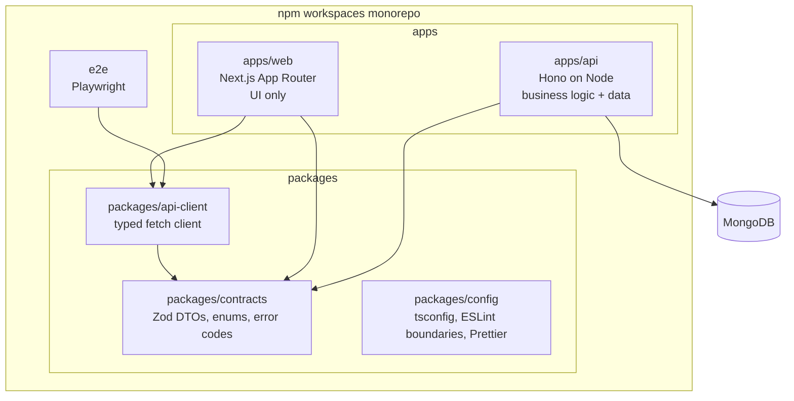
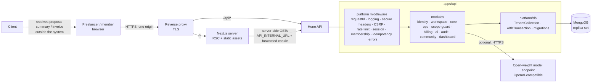
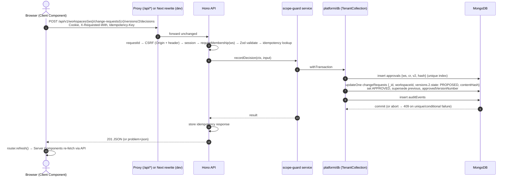
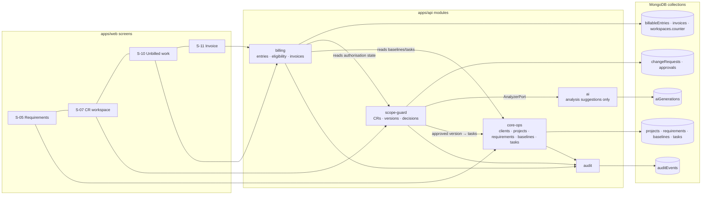
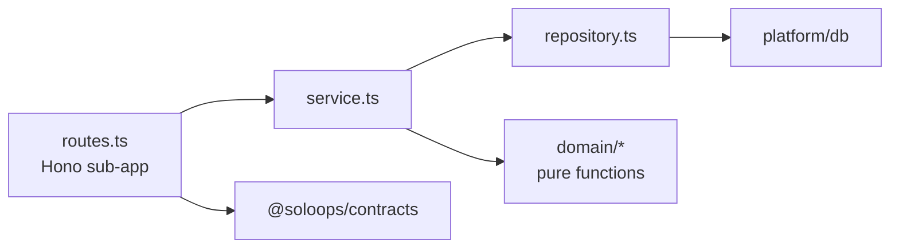

# Architecture Overview

> **Status:** Proposed. No code exists yet ([repository assessment](../repository-assessment.md)). When implementation diverges, update this document or write an ADR. Never leave them inconsistent.

## Key decisions at a glance

| Concern | Decision | ADR |
| --- | --- | --- |
| Web | Next.js App Router + React + TypeScript. Presentation only | [0009](adr/0009-nextjs-app-router-frontend.md) |
| API | Hono on Node.js + TypeScript. The only home of business logic | [0010](adr/0010-hono-api-on-node.md) |
| Shape | Modular monolith API + separate web app | [0003](adr/0003-modular-monolith.md) |
| Monorepo | npm workspaces. `packages/contracts` (Zod), `packages/api-client`, `packages/config` | [0011](adr/0011-monorepo-packages-and-contracts.md) |
| Data | MongoDB replica set, native driver, tenant-scoped data-access layer, transactions | [0012](adr/0012-mongodb-and-data-access.md) |
| Transport | Same-origin `/api/*`. Server Components fetch the API with forwarded cookies | [0013](adr/0013-web-api-communication.md) |
| Auth | Server-side sessions, argon2id, cookies, workspace membership checks | [0004](adr/0004-authentication-and-sessions.md) |
| AI | Provider-independent port: `none`, `mock`, `openai-compatible` | [0005](adr/0005-ai-provider-abstraction.md) |
| Approvals | Immutable proposal versions with hash-bound decisions | [0006](adr/0006-versioned-approvals.md) |
| Money | Integer minor units, computed only in the API | [0007](adr/0007-financial-calculations.md) |
| Testing | Vitest, in-process Hono requests on a real MongoDB, RTL, Playwright | [0014](adr/0014-testing-strategy-for-next-hono-mongodb.md) |

## 1. Monorepo structure

Details, responsibilities and enforcement are in [monorepo structure](monorepo-structure.md).

## 2. System components

The client has **no direct connection** to the system in the MVP.

## 3. Request flow (example: record a client decision)

Read path: a Server Component calls `serverApi.get('/api/v1/...')`. That call goes straight to `API_INTERNAL_URL` with the user's `Cookie` header and `cache: 'no-store'`, and runs through the same middleware chain ([ADR-0013](adr/0013-web-api-communication.md)).

## 4. Core business workflow mapped to components

Business sequence: baseline requirements → record CR → optional AI suggestion → propose (freeze + hash) → record decision → convert to tasks → log entries → eligibility → invoice draft → owner issues. The step-by-step flows are in [workflows](../design/workflows.md), and the states are in [change-request lifecycle](../design/change-request-lifecycle.md).

## Dependency direction (inside the API)

Rules:
1. Modules import each other only via `index.ts`.
2. `ai` imports no domain module.
3. Only `platform/db` imports `mongodb`.
4. Repositories use `TenantCollection`.
5. `domain/` is pure.

## Cross-cutting concerns

| Concern | Approach | Detail |
| --- | --- | --- |
| Tenant isolation | Workspace in the URL. `requireMembership`. `TenantCollection` injects `workspaceId`. Foreign IDs → 404 | [security](security-architecture.md), [data model](data-model.md) |
| Validation | Zod contracts shared by web forms and API validators | [monorepo](monorepo-structure.md) |
| Errors | RFC 9457 problem+json with a stable `code` | [API design](api-design.md) |
| Audit | `auditEvents` inserted inside the same MongoDB transaction | [data model](data-model.md) |
| Caching | No caching of authenticated data in Next.js or the API | [frontend](frontend-architecture.md) |
| Observability | pino JSON logs with request ID propagated web → API. `/healthz`, `/readyz` | [deployment](deployment-architecture.md) |

## External dependencies

| Dependency | Required? | Notes |
| --- | --- | --- |
| MongoDB (replica set) | Yes | Single-node replica set for local and CI. Version pinned in M1 |
| Model inference endpoint | No | Any OpenAI-compatible chat completions endpoint. Cost depends on the operator |
| Email / payments / chat apps | No | Out of scope for MVP |

## Further reading

[Monorepo structure](monorepo-structure.md) · [Frontend](frontend-architecture.md) · [Backend](backend-architecture.md) · [Data model](data-model.md) · [API design](api-design.md) · [AI](ai-architecture.md) · [Security](security-architecture.md) · [Deployment](deployment-architecture.md) · [Testing strategy](testing-strategy.md) · [ADRs](adr/README.md)
