# Backend Architecture

> **Status:** Implemented for M1–M5: the `identity`, `workspace`, `core-ops`, `scope-guard`, `billing`, `ai` and `audit` modules exist in `apps/api/src/modules`. The `community` and `dashboard` modules are **planned (not built)**. Decisions: [ADR-0003 (modular monolith)](adr/0003-modular-monolith.md), [ADR-0010 (Hono)](adr/0010-hono-api-on-node.md), [ADR-0012 (MongoDB)](adr/0012-mongodb-and-data-access.md).

## Style: modular monolith on Hono

`apps/api` is a single Node.js process running a Hono app, with strongly bounded modules. Microservices are rejected for the MVP: approval and invoicing need multi-document transactions, and the operational cost would outweigh any benefit at this scale.

## Source layout

```text
apps/api/src/
├── main.ts                 # load config → connect Mongo → createApp(deps) → serve (@hono/node-server); graceful shutdown
├── app.ts                  # createApp(deps): mounts middleware and module routers; exported for tests
├── platform/
│   ├── config/             # Zod-validated env (see environment-configuration.md)
│   ├── db/                 # the ONLY importer of `mongodb`: client, TenantCollection, withTransaction, collection registry
│   ├── http/               # middleware: requestId, logger, secureHeaders, csrf, bodyLimit, rateLimit,
│   │                       #   session, requireMembership, idempotency, onError (problem+json)
│   ├── logging/            # pino with redaction
│   ├── clock.ts, ids.ts    # injected clock, UUIDv7
│   └── errors.ts           # typed domain errors
└── modules/<module>/
    ├── index.ts            # PUBLIC API: the only file other modules may import
    ├── routes.ts           # Hono sub-app: Zod validation (contracts) → service → DTO mapping
    ├── service.ts          # use cases, transactions, authorisation decisions, audit writes
    ├── repository.ts       # MongoDB queries via TenantCollection (workspaceId always applied)
    ├── documents.ts        # persistence types + mappers to/from @soloops/contracts DTOs
    ├── domain/             # pure functions: state machines, calculations, hashing
    └── *.test.ts
```

| Module | Owns collections | Public API (examples) |
| --- | --- | --- |
| `identity` | users, sessions | `authenticate()`, `sessionMiddleware` |
| `workspace` | workspaces, memberships | `requireMembership(role?)`, `getSettings()`, `nextInvoiceNumber(tx, ws)` |
| `core-ops` | clients, projects, requirements, baselines, tasks | `getProject()`, `isRequirementBaselined()`, `createTasksFromVersion(tx, …)` |
| `scope-guard` | changeRequests, approvals | `getAuthorisationState(ws, { changeRequestId, versionNumber })` |
| `billing` | billableEntries, invoices | `classifyEntries()` |
| `ai` | aiGenerations | `AnalyzerPort` implementation `analyzeChangeRequest()` |
| `audit` | auditEvents | `record(tx, event)` |
| `community` *(planned, not built)* | — (templates as files) | `exportWorkspace()` |
| `dashboard` *(planned, not built)* | — (read-only composition) | `getDashboard(ctx)`. It calls the public read APIs of scope-guard, billing and core-ops. **No module depends on `dashboard`**, and it performs no writes (FR-017) |
| `platform` | idempotencyKeys, schemaMigrations | middleware and db helpers |

A module **must not** query another module's collections. It calls that module's public API and passes the transaction session when atomicity is needed.

## Request pipeline

```mermaid
flowchart LR
    R[Request] --> RID[requestId] --> LOG[logger] --> SEC[secureHeaders + bodyLimit 256kb]
    SEC --> CSRF[CSRF: Origin = APP_ORIGIN<br/>+ X-Requested-With on unsafe methods]
    CSRF --> RL[rateLimit<br/>auth & AI routes] --> SESS[session → c.var.user]
    SESS --> MEM["requireMembership<br/>/workspaces/:workspaceId/* → c.var.ctx"] --> VAL[Zod validator<br/>from @soloops/contracts]
    VAL --> IDEM[idempotency<br/>transition routes] --> H[route → service]
    H --> ERR[app.onError → problem+json]
```



Mounting: `app.route('/api/v1/auth', identity.routes)` and `app.route('/api/v1/workspaces/:workspaceId', tenantRouter)`. `tenantRouter` applies `requireMembership` once and then mounts the module routers. Context variables (`user`, `ctx`, `requestId`) are typed through Hono's `Variables` generic.

## Workspace authorisation

1. `session` resolves the user from the `soloops_sid` cookie. Missing or expired → `401` on protected routes.
2. `requireMembership({ role? })` loads `memberships` by `{ workspaceId, userId }`:
   - Not a member → `404` (no existence leak).
   - Wrong role → `403`.
   - Otherwise it sets `c.var.ctx = { userId, workspaceId, role }`.
3. Services receive `ctx` and DTOs, never the Hono context.
4. Repositories receive `TenantCollection`s, which add `workspaceId` to **every** filter, insert and `$match`, and reject documents or updates that try to set `workspaceId`.
5. When linking documents (for example a task to a CR version), the service loads the target **through the same workspace scope** first. A foreign ID therefore looks like "not found" (MongoDB has no FKs, see [ADR-0012](adr/0012-mongodb-and-data-access.md)).
6. TC-SEC-01/02 iterate over the Hono route table to prove that every tenant route returns `404` for foreign resources.

## Transactions and concurrency

`withTransaction(async (session) => …)` uses majority write concern and snapshot read concern. The driver retries transient errors. MongoDB has no row locks, so races are resolved by **conditional updates** (the filter includes the expected state) and **unique indexes**. A conflicting writer matches zero documents or gets a duplicate-key error, which maps to `409`.

| Use case | Atomic guard | Writes in one transaction |
| --- | --- | --- |
| Create baseline | `projects` update conditioned on `rowVersion` | baseline insert, requirements `baselineId` set (only where null), audit |
| Propose version | CR update where `versions[n].state = DRAFT` and `rowVersion` matches | state, hash, rate, price, `openVersionNumber` kept, audit |
| Record decision | unique `approvals` index + CR update where `versions[n].state = PROPOSED` and the hash matches | approval insert, version state, supersede previous approved, `approvedVersionNumber`, `openVersionNumber = null`, audit |
| Create new version | CR update where `openVersionNumber = null` | push version, set `openVersionNumber`, audit |
| Convert to tasks | CR read inside the transaction, with state `APPROVED` | task inserts, audit |
| Create invoice draft | each entry update where `invoiceId = null` (all must match, else abort) | invoice insert with embedded lines, entries reserved, audit |
| Issue invoice | invoice update where `status = DRAFT` and `rowVersion` matches. Workspace `$inc` counter | number, status, audit, idempotency record |
| Void invoice | invoice update where `status = ISSUED` | status, entries `invoiceId = null`, audit |

## Idempotency

`Idempotency-Key` on transition `POST`s. It is required for decisions, issue and void. The `idempotencyKeys` collection is unique on `{workspaceId, key}`, with a TTL of 24 h:
- The same key and the same request hash return the stored response.
- The same key with a different body returns `422 IDEMPOTENCY_KEY_REUSED`.

For issue and decisions, the record is written **inside** the business transaction.

## Optimistic concurrency

Mutable resources return `ETag: "<rowVersion>"`. `PATCH` requires `If-Match`. The update filter includes `rowVersion`, and zero matches → `412`. Each successful update applies `$inc: { rowVersion: 1 }`.

## Errors

Typed domain errors (`NotFound`, `Forbidden`, `Conflict(code)`, `ValidationFailed(issues)`, `PreconditionFailed`, `AiUnavailable`) are mapped by `app.onError` to RFC 9457 problem+json. Problem codes are defined in `@soloops/contracts`. A MongoDB duplicate-key error on a guarded index becomes the matching `409` code. Unknown errors become `500` with the request ID, and the full error is logged server-side.

## Logging

pino JSON with `requestId`, `userId`, `workspaceId`, `route`, `status` and `durationMs`. The request ID arrives from the web server-side helper via `X-Request-Id` (or is generated). Redaction covers `password`, `cookie`, `authorization`, `AI_API_KEY`, the MongoDB URI and auth request bodies. Raw CR text and client PII are not logged.

## Configuration

Loaded once at startup and validated with Zod. Startup fails on invalid required config, with the message naming the variable but never its value. See [environment configuration](../engineering/environment-configuration.md).
