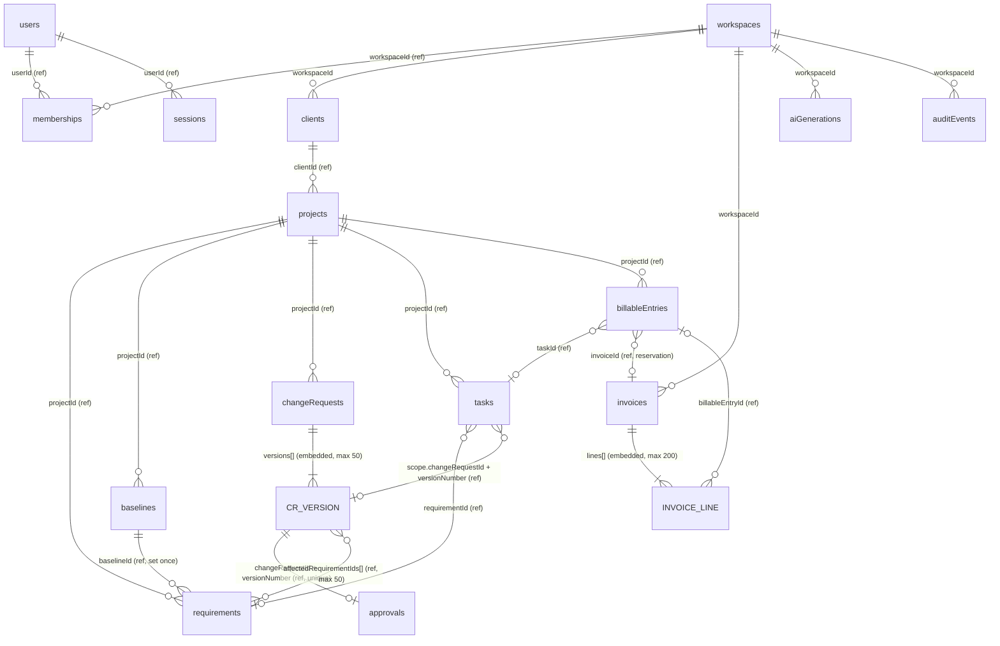

# Data Model (MongoDB)

> **Status:** §4.1–4.4 and §4.15–4.17 (`users`, `sessions`, `workspaces`, `memberships`, `auditEvents`, `idempotencyKeys`, `schemaMigrations`) are **implemented** by migration `0001-identity-and-workspaces` (M1). §4.5–4.8 and §4.11 (`clients`, `projects`, `requirements`, `baselines`, `tasks`) are **implemented** by migration `0002-core-ops` (M2, [ADR-0017](adr/0017-m2-core-ops-implementation-choices.md)). §4.9, §4.10 and §4.14 (`changeRequests`, `approvals`, `aiGenerations`) are **implemented** by migration `0003-scope-guard-and-ai` (M3, [ADR-0018](adr/0018-m3-scope-guard-and-ai-implementation-choices.md)). §4.13 (`invoices`) is **implemented** by migration `0005-invoices` (M5, [ADR-0020](adr/0020-m5-invoice-implementation-choices.md)). Migration `0006-scope-check` adds the optional `versions[].scopeVerdict` and `versions[].questionsForClient`, and `0007-membership-version` the optional `workspaces.membershipVersion` ([ADR-0022](adr/0022-scope-check-and-members.md)); both extend the current validator in place. §4.12 (`billableEntries`) and the optional `tasks.origin` are **implemented** by migration `0004-delivery-and-billable-work` (M4, [ADR-0019](adr/0019-m4-delivery-and-billable-work-implementation-choices.md)). Everything else is **proposed** (see [implementation status](../quality/implementation-status.md)). Workspace defaults at registration: `INR`, rate `0`, tax label `Tax`, `0` bps, prefix `INV`, `Asia/Kolkata`, and legal name = the user's name. Workspace `name` is 1–120 characters. Registration writes a `member.added` audit event for the founding owner. Once implemented, the authoritative definitions are the document types and Zod schemas in `apps/api/src/modules/*/documents.ts`, plus the validators and indexes in `apps/api/migrations/`. Update this document in the same PR as any schema change.
>
> Decisions: [ADR-0012](adr/0012-mongodb-and-data-access.md) (MongoDB, native driver, `TenantCollection`), [ADR-0006](adr/0006-versioned-approvals.md) (versioned approvals), [ADR-0007](adr/0007-financial-calculations.md) (money). This is the single data-model source of truth. The design section links here instead of duplicating it.

## 1. Design principles

1. **Model aggregates, not tables.** Data that changes together and is read together is embedded: CR versions in the CR, invoice lines in the invoice. Everything else is referenced.
2. **No unbounded arrays.** Every embedded array has a hard `maxItems` enforced by the `$jsonSchema` validator and by Zod. Growth that is not naturally bounded (requirements, tasks, entries, approvals, audit) gets its own collection.
3. **Invariants via single-document atomicity first, transactions second.** State machines are conditional `updateOne` calls on one document. Cross-collection consistency (approval + audit, invoice + entries) uses a replica-set transaction.
4. **Tenant first.** Every tenant document has `workspaceId`, and every index on tenant collections starts with `workspaceId`.
5. **Immutable evidence.** `approvals` and `auditEvents` are insert-only. Proposed versions and issued invoices are frozen by state-conditional updates.
6. **API-generated IDs.** `_id` is a UUIDv7 string. It sorts by creation time, which enables keyset pagination without an extra field.

## 2. Collection relationship diagram



`CR_VERSION` and `INVOICE_LINE` are embedded sub-documents, not collections.

## 3. Embed vs reference decisions

| Data | Decision | Why |
| --- | --- | --- |
| CR versions → change request | **Embed** (`versions[]`, max 50) | Read together on every CR screen. State transitions must be atomic across versions (supersede old approved, set new approved) |
| Decision → version | **Reference** (`approvals` collection) plus a small immutable **summary copy** on the version | The insert-only collection gives tamper-resistance and a unique index per version. The summary copy avoids a second read when rendering the CR |
| Invoice lines → invoice | **Embed** (`lines[]`, max 200) | Always read and written with the invoice. Totals must be consistent within one document |
| Requirements → project | **Reference** | Unbounded, individually edited, referenced by tasks, entries and CR versions |
| Requirements → baseline | **Reference** (`requirements.baselineId`) | Avoids copying requirements into an ever-growing snapshot array. Baselined requirements are immutable, so the baseline hash can always be recomputed |
| Tasks, billable entries → project | **Reference** | Unbounded. Queried by status, date and eligibility |
| Entry → invoice | **Reference** (`billableEntries.invoiceId`) | Enforces one non-void invoice per entry with a conditional update |
| Memberships | **Separate collection** | Queried both ways (a user's workspaces, a workspace's members). Avoids embedding unbounded member lists |
| Audit events, AI generations | **Separate collections** | Append-only, unbounded, different retention |
| Client contact → client | **Embed** (flat fields) | 1:1, small |

## 4. Collections

Conventions used in the dictionaries: **Type** is the BSON type (`string`, `int` = Int32, `long` = Int64, `date`, `bool`, `object`, `array`). **Req** marks a required field. Every tenant collection also has `createdAt` and `updatedAt` (`date`, required); these are omitted from the tables. JSON examples use MongoDB Extended JSON (`$numberLong`, `$date`).

### 4.1 `users` (global)

```json
{
  "_id": "0192a000-0000-7000-8000-0000000000a1",
  "email": "riya@example.com",
  "name": "Riya Sen",
  "passwordHash": "$argon2id$v=19$m=19456,t=2,p=1$…",
  "createdAt": { "$date": "2026-10-01T09:00:00Z" },
  "updatedAt": { "$date": "2026-10-01T09:00:00Z" }
}
```

| Field | Type | Req | Rules |
| --- | --- | --- | --- |
| `_id` | string | ✓ | UUIDv7 |
| `email` | string | ✓ | lower-cased, ≤ 254, **unique** |
| `name` | string | ✓ | 1–120 |
| `passwordHash` | string | ✓ | argon2id encoded. Never returned by the API |

**Indexes:** `{ email: 1 }` unique. **Access:** login by email. Membership resolution uses `memberships`.

### 4.2 `sessions` (global)

```json
{
  "_id": "9f2c…sha256-of-token…",
  "userId": "0192a000-0000-7000-8000-0000000000a1",
  "createdAt": { "$date": "2026-10-16T08:00:00Z" },
  "lastSeenAt": { "$date": "2026-10-16T10:30:00Z" },
  "expiresAt": { "$date": "2026-10-23T10:30:00Z" },
  "absoluteExpiresAt": { "$date": "2026-11-15T08:00:00Z" }
}
```

`_id` is the SHA-256 of the cookie token, so the raw token is never stored. `expiresAt` slides with activity but never passes `absoluteExpiresAt`.
**Indexes:** TTL `{ expiresAt: 1 }` (`expireAfterSeconds: 0`) and `{ userId: 1 }` (sign out everywhere).

### 4.3 `workspaces`

```json
{
  "_id": "0192a000-0000-7000-8000-000000000001",
  "name": "Riya Sen Studio",
  "defaultCurrency": "INR",
  "defaultHourlyRateMinor": { "$numberLong": "150000" },
  "taxLabel": "GST",
  "taxRateBps": 1800,
  "invoicePrefix": "RS",
  "timeZone": "Asia/Kolkata",
  "nextInvoiceNumber": 8,
  "billingDetails": { "legalName": "Riya Sen", "address": "Kolkata, West Bengal", "taxId": null },
  "aiEnabled": true,
  "aiEnabledAt": { "$date": "2026-10-02T11:00:00Z" },
  "aiEnabledByUserId": "0192a000-0000-7000-8000-0000000000a1",
  "rowVersion": 4,
  "createdAt": { "$date": "2026-10-01T09:00:00Z" },
  "updatedAt": { "$date": "2026-10-02T11:00:00Z" }
}
```

| Field | Type | Req | Rules |
| --- | --- | --- | --- |
| `defaultCurrency` | string | ✓ | ISO 4217, 3 uppercase letters |
| `defaultHourlyRateMinor` | long | ✓ | ≥ 0 |
| `taxLabel` | string | ✓ | 1–20. Label only, no compliance claim ([OQ-002](../product/open-questions.md)) |
| `taxRateBps` | int | ✓ | 0–10000 |
| `invoicePrefix` | string | ✓ | `^[A-Z0-9-]{1,10}$` |
| `timeZone` | string | ✓ | IANA zone, default `Asia/Kolkata`. Defines "today" for date validations such as `decidedOn ≤ today` |
| `nextInvoiceNumber` | int | ✓ | ≥ 1. Changed **only** by `$inc` inside the issue transaction (BR-023) |
| `billingDetails` | object | ✓ | Shown on invoice and proposal print views |
| `aiEnabled` | bool | ✓ | Default `false` (FR-054) |
| `membershipVersion` | int | | Optional (migration 0007). `$inc` in every membership change so concurrent changes conflict and the last `OWNER` can never be removed (FR-004, [ADR-0022](adr/0022-scope-check-and-members.md)). Not a settings change: does not bump `rowVersion` |
| `rowVersion` | int | ✓ | Optimistic concurrency for settings |

The tenant key is `_id`. `TenantCollection` maps `workspaceId` to `_id` for this collection.

### 4.4 `memberships`

```json
{
  "_id": "0192a000-0000-7000-8000-0000000000f1",
  "workspaceId": "0192a000-0000-7000-8000-000000000001",
  "userId": "0192a000-0000-7000-8000-0000000000a1",
  "role": "OWNER",
  "createdAt": { "$date": "2026-10-01T09:00:00Z" },
  "updatedAt": { "$date": "2026-10-01T09:00:00Z" }
}
```

`role` is one of `OWNER` or `MEMBER`.
**Indexes:** `{ workspaceId: 1, userId: 1 }` unique (checked on every tenant request) and `{ userId: 1 }` (workspace switcher). The service keeps ≥ 1 `OWNER`.

### 4.5 `clients`

```json
{
  "_id": "0192a000-0000-7000-8000-0000000000c1",
  "workspaceId": "0192a000-0000-7000-8000-000000000001",
  "name": "Das Sweets Pvt Ltd",
  "contactName": "S. Das",
  "email": "orders@das-sweets.example.com",
  "phone": "+91 90000 00000",
  "billingAddress": "Park Street, Kolkata",
  "taxId": null,
  "archivedAt": null,
  "rowVersion": 1,
  "createdAt": { "$date": "2026-10-01T09:10:00Z" },
  "updatedAt": { "$date": "2026-10-01T09:10:00Z" }
}
```

| Field | Type | Req | Rules |
| --- | --- | --- | --- |
| `name` | string | ✓ | 1–160 |
| `contactName`, `email`, `phone`, `billingAddress`, `taxId` | string or null | | Lengths ≤ 160/254/32/500/32 |
| `archivedAt` | date or null | ✓ | Non-null means read-only (BR-029) |
| `activityVersion` | int | ✓ | Internal, not in the API. Incremented when a project is created for the client, so a concurrent client archive conflicts (ADR-0017 §4) |

**Indexes:** `{ workspaceId: 1, archivedAt: 1, name: 1, _id: 1 }` `workspace_archived_name` (list active clients alphabetically; `_id` breaks ties for keyset pagination).

### 4.6 `projects`

```json
{
  "_id": "0192a000-0000-7000-8000-0000000000e1",
  "workspaceId": "0192a000-0000-7000-8000-000000000001",
  "clientId": "0192a000-0000-7000-8000-0000000000c1",
  "name": "Online ordering app",
  "description": "Customer ordering for 3 outlets",
  "billingModel": "HOURLY",
  "currency": "INR",
  "hourlyRateMinor": { "$numberLong": "150000" },
  "startDate": "2026-10-01",
  "status": "ACTIVE",
  "archivedAt": null,
  "counters": { "requirement": 6, "changeRequest": 3, "baseline": 1 },
  "rowVersion": 3,
  "createdAt": { "$date": "2026-10-01T09:15:00Z" },
  "updatedAt": { "$date": "2026-10-12T10:00:00Z" }
}
```

| Field | Type | Req | Rules |
| --- | --- | --- | --- |
| `clientId` | string | ✓ | Client in the same workspace, not archived at creation |
| `billingModel` | string | ✓ | `HOURLY` or `FIXED` |
| `currency` | string | ✓ | ISO 4217. Immutable after the first billable entry |
| `hourlyRateMinor` | long or null | | Overrides the workspace default (BR-021) |
| `status` | string | ✓ | `ACTIVE`, `ON_HOLD` or `COMPLETED` |
| `counters.*` | int | ✓ | Allocated with `$inc` and `returnDocument: 'after'`. Numbers are never reused |
| `activityVersion` | int | ✓ | Internal, not in the API. Incremented by every write to a requirement, baseline or task of the project and by a client archive. This guarantees a real write, so concurrent transactions conflict (ADR-0017 §4) |

**Indexes:** `{ workspaceId: 1, archivedAt: 1, updatedAt: -1, _id: -1 }` `workspace_archived_recent` (project list, recently active first) and `{ workspaceId: 1, clientId: 1 }` `workspace_client` (client detail). `updatedAt` also moves when a requirement, baseline or task of the project is written (ADR-0017 §4). A project is read-only when it **or its client** is archived (BR-029).

### 4.7 `requirements`

```json
{
  "_id": "0192a000-0000-7000-8000-0000000000c2",
  "workspaceId": "0192a000-0000-7000-8000-000000000001",
  "projectId": "0192a000-0000-7000-8000-0000000000e1",
  "number": 2,
  "title": "Customer login",
  "description": "Customers log in with email and password.",
  "acceptanceCriteria": ["Login with valid credentials", "Lockout after 5 failed attempts"],
  "priority": "MUST",
  "baselineId": "0192a000-0000-7000-8000-0000000000b1",
  "deletedAt": null,
  "rowVersion": 2,
  "createdAt": { "$date": "2026-10-02T09:00:00Z" },
  "updatedAt": { "$date": "2026-10-03T09:00:00Z" }
}
```

| Field | Type | Req | Rules |
| --- | --- | --- | --- |
| `number` | int | ✓ | From `projects.counters.requirement`. Displayed as `REQ-2` |
| `title` | string | ✓ | 1–200 |
| `description` | string | ✓ | ≤ 10,000 |
| `acceptanceCriteria` | array of string | ✓ | ≤ 30 items, each ≤ 300 |
| `priority` | string | ✓ | `MUST`, `SHOULD` or `COULD` |
| `baselineId` | string or null | ✓ | Set once. Afterwards the document is immutable (BR-004) |
| `deletedAt` | date or null | ✓ | Only while `baselineId` is null (soft delete keeps numbering honest) |

**Indexes:** `{ workspaceId: 1, projectId: 1, number: 1 }` unique, and `{ workspaceId: 1, projectId: 1, baselineId: 1 }` (draft vs baselined lists, baseline creation).
**Bound:** at most 500 active (not deleted) requirements per project; the 501st returns `422` (ADR-0017 §10).
**Atomic guard:** every update filter includes `baselineId: null` and `rowVersion`.

### 4.8 `baselines`

```json
{
  "_id": "0192a000-0000-7000-8000-0000000000b1",
  "workspaceId": "0192a000-0000-7000-8000-000000000001",
  "projectId": "0192a000-0000-7000-8000-0000000000e1",
  "sequence": 1,
  "requirementCount": 5,
  "contentHash": "5c1e0b…64-hex…",
  "createdByUserId": "0192a000-0000-7000-8000-0000000000a1",
  "createdAt": { "$date": "2026-10-03T09:00:00Z" },
  "updatedAt": { "$date": "2026-10-03T09:00:00Z" }
}
```

`contentHash` is the SHA-256 of the canonical JSON of the frozen requirements, sorted by `number`. Each one is serialised as `{ number, title, description, acceptanceCriteria, priority }` in that key order, with no IDs or timestamps (ADR-0017 §2, `apps/api/src/modules/core-ops/domain/baseline-hash.ts`). Because baselined requirements are immutable, the hash can be **recomputed and verified** at any time. No snapshot array is stored, which avoids an unbounded embed.
**Indexes:** `{ workspaceId: 1, projectId: 1, sequence: 1 }` unique.
**Write:** one transaction inserts the baseline, runs `updateMany` on requirements `{ projectId, baselineId: null, deletedAt: null }` with `$set baselineId`, and writes audit. Concurrent baselines are prevented by the `$inc` of `projects.counters.baseline` at the start of the transaction: a second transaction writing the same project gets a write conflict and retries, then finds nothing to freeze (`422`). The project `rowVersion` is not used for this (ADR-0017 §3).

### 4.9 `changeRequests` (aggregate with embedded versions)

```json
{
  "_id": "0192a000-0000-7000-8000-0000000000d3",
  "workspaceId": "0192a000-0000-7000-8000-000000000001",
  "projectId": "0192a000-0000-7000-8000-0000000000e1",
  "number": 3,
  "rawRequestText": "Can you also add login with WhatsApp OTP? Need it before Diwali sale.",
  "sourceChannel": "CHAT",
  "requestedByName": "S. Das",
  "receivedOn": "2026-10-12",
  "openVersionNumber": null,
  "approvedVersionNumber": 2,
  "latestVersionNumber": 2,
  "derivedStatus": "APPROVED",
  "versions": [
    {
      "number": 1,
      "state": "REJECTED",
      "title": "WhatsApp OTP login",
      "clarifiedDescription": "Add phone login with OTP over WhatsApp, replacing email login.",
      "inScope": ["OTP endpoints", "Login screen option"],
      "outOfScope": ["SMS fallback"],
      "acceptanceCriteria": ["OTP arrives within 30 s"],
      "affectedRequirementIds": ["0192a000-0000-7000-8000-0000000000c2"],
      "dependencies": ["Client WhatsApp Business provider account"],
      "assumptions": ["Phone numbers already verified"],
      "effort": { "lowMinutes": 360, "likelyMinutes": 480, "highMinutes": 840 },
      "confirmedEffortMinutes": 480,
      "pricing": { "mode": "TIME", "hourlyRateMinor": { "$numberLong": "150000" }, "priceMinor": { "$numberLong": "1200000" }, "currency": "INR" },
      "timelineImpact": "2–4 working days",
      "risks": [{ "description": "Provider approval delay", "severity": "MEDIUM" }],
      "aiFieldProvenance": { "clarifiedDescription": "0192a000-0000-7000-8000-0000000000b5" },
      "contentHash": "a41f…64-hex…",
      "proposedAt": { "$date": "2026-10-12T12:00:00Z" },
      "proposedByUserId": "0192a000-0000-7000-8000-0000000000a1",
      "decision": { "approvalId": "0192a000-0000-7000-8000-0000000000d1", "decision": "REJECTED", "decidedOn": "2026-10-13" }
    },
    {
      "number": 2,
      "state": "APPROVED",
      "title": "WhatsApp OTP login (in addition to email)",
      "clarifiedDescription": "Add phone login with OTP over WhatsApp alongside existing email login.",
      "inScope": ["OTP endpoints", "Login screen option"],
      "outOfScope": ["SMS fallback", "Provider fees"],
      "acceptanceCriteria": ["OTP arrives within 30 s", "OTP expires after 5 min", "Email login unchanged"],
      "affectedRequirementIds": ["0192a000-0000-7000-8000-0000000000c2"],
      "dependencies": ["Client WhatsApp Business provider account"],
      "assumptions": ["Phone numbers already verified", "Provider sandbox available"],
      "effort": { "lowMinutes": 360, "likelyMinutes": 480, "highMinutes": 840 },
      "confirmedEffortMinutes": 540,
      "pricing": { "mode": "TIME", "hourlyRateMinor": { "$numberLong": "150000" }, "priceMinor": { "$numberLong": "1350000" }, "currency": "INR" },
      "timelineImpact": "3–4 working days",
      "risks": [{ "description": "Provider approval delay", "severity": "MEDIUM" }],
      "aiFieldProvenance": {},
      "contentHash": "3f9a…64-hex…",
      "proposedAt": { "$date": "2026-10-13T15:00:00Z" },
      "proposedByUserId": "0192a000-0000-7000-8000-0000000000a1",
      "decision": { "approvalId": "0192a000-0000-7000-8000-0000000000d2", "decision": "APPROVED", "decidedOn": "2026-10-14" }
    }
  ],
  "createdByUserId": "0192a000-0000-7000-8000-0000000000a1",
  "rowVersion": 7,
  "createdAt": { "$date": "2026-10-12T11:00:00Z" },
  "updatedAt": { "$date": "2026-10-14T06:00:00Z" }
}
```

| Field | Type | Req | Rules |
| --- | --- | --- | --- |
| `number` | int | ✓ | From `projects.counters.changeRequest`. Displayed as `CR-3` |
| `rawRequestText` | string | ✓ | ≤ 20,000. **Immutable** (evidence) |
| `sourceChannel` | string | ✓ | `EMAIL`, `CHAT`, `CALL`, `MEETING`, `IN_PERSON` or `OTHER` |
| `receivedOn` | string | ✓ | `YYYY-MM-DD`, not in the future |
| `openVersionNumber` | int or null | ✓ | Number of the single `DRAFT`/`PROPOSED` version (BR-009) |
| `approvedVersionNumber` | int or null | ✓ | Number of the single `APPROVED` version |
| `latestVersionNumber` | int | ✓ | Highest version number |
| `derivedStatus` | string | ✓ | Recomputed in **every** transition update from the [lifecycle table](../design/change-request-lifecycle.md#derived-cr-status-for-lists-and-filters). Stored only for indexed filtering (dashboard and approvals queue). Never set independently |
| `versions` | array | ✓ | 1–**50** items ([OQ-014](../product/open-questions.md)) |
| `versions[].state` | string | ✓ | `DRAFT`, `PROPOSED`, `APPROVED`, `REJECTED`, `CLARIFICATION_REQUESTED`, `WITHDRAWN` or `SUPERSEDED` |
| `versions[].inScope/outOfScope/acceptanceCriteria/dependencies/assumptions` | array of string | ✓ | ≤ 20 items each, each ≤ 300. Proposing requires ≥ 1 acceptance criterion and ≥ 1 assumption (BR-007) |
| `versions[].affectedRequirementIds` | array of string | ✓ | ≤ 50. Requirements of the same project |
| `versions[].effort.*Minutes` | int | | low ≤ likely ≤ high, each 1–120,000 (≤ 2,000 h, BR-026) |
| `versions[].pricing` | object | on propose | `mode` `TIME` (needs `confirmedEffortMinutes` and a resolved `hourlyRateMinor`) or `FIXED` (needs `priceMinor`). `priceMinor` for `TIME` is **computed by the API** (BR-020) |
| `versions[].risks` | array | ✓ | ≤ 10. `severity` is `LOW`, `MEDIUM` or `HIGH` |
| `versions[].scopeVerdict` | string or null | | Optional (migration 0006): the **person-confirmed** scope verdict `NEW_SCOPE`, `CHANGES_AGREED_SCOPE`, `LIKELY_ALREADY_COVERED` or `UNCLEAR` (BR-031). Draft-only edits; hashed when set |
| `versions[].questionsForClient` | array of string | | Optional (migration 0006): ≤ 20 items, each ≤ 300, most important first. Draft-only edits; hashed when non-empty. Shown on the proposal summary |
| `versions[].contentHash` | string | on propose | SHA-256 hex of the canonical content ([lifecycle](../design/change-request-lifecycle.md#content-hash)) |
| `versions[].decision` | object | after decision | Immutable summary copy of the `approvals` record |

> Note on `derivedStatus`: the earlier design said derived status is "never stored". This design stores it as a **computed cache written atomically by the same update that changes version states**, because the approvals queue and dashboard need an index on it. It is never accepted from clients. [Change-request lifecycle](../design/change-request-lifecycle.md) has been updated to match.

**Indexes:**
- `{ workspaceId: 1, projectId: 1, number: 1 }` unique.
- `{ workspaceId: 1, projectId: 1, _id: -1 }` (project CR list, newest first).
- `{ workspaceId: 1, derivedStatus: 1, updatedAt: -1, _id: -1 }` `workspace_status_recent` (approvals queue, dashboard; `_id` for keyset pagination).

**As implemented (M3):** every version-state change goes through one repository function, `writeVersions`. It rewrites the bounded `versions` array, the derived pointers and `derivedStatus` in one update, guarded by the `rowVersion` read in the transaction plus the state condition shown below ([ADR-0018](adr/0018-m3-scope-guard-and-ai-implementation-choices.md) §2). Version `pricing` is stored as `{ mode, hourlyRateMinor, priceMinor, currency }`; `priceMinor` is computed on every draft save and frozen at propose.

**Atomic transitions** (all inside a transaction because audit must commit with them):

| Transition | Filter guard | Update |
| --- | --- | --- |
| Edit draft | `{ _id, workspaceId, rowVersion, "versions": { $elemMatch: { number: n, state: "DRAFT" } } }` | `$set` content fields via `versions.$[v]`, `$inc rowVersion` |
| Propose | same filter, plus the completeness pre-check in the service | `state: PROPOSED`, `contentHash`, `pricing`, `proposedAt`, `derivedStatus` |
| Record decision | `{ …, "versions": { $elemMatch: { number: n, state: "PROPOSED", contentHash: h } } }`, together with a unique insert into `approvals` | new state, `decision` summary, `openVersionNumber: null`. If approved: previous approved version set to `SUPERSEDED` and `approvedVersionNumber: n` |
| New version | `{ _id, workspaceId, openVersionNumber: null, latestVersionNumber: k }` and the `versions` array size < 50 | `$push` a copy of version k as `DRAFT` k+1, `openVersionNumber: k+1`, `latestVersionNumber: k+1` |
| Withdraw | `state: "PROPOSED"` | `state: WITHDRAWN`, `openVersionNumber: null` |

Zero matched documents means a `409` (or a `412` when only `rowVersion` failed).

### 4.10 `approvals` (insert-only)

```json
{
  "_id": "0192a000-0000-7000-8000-0000000000d2",
  "workspaceId": "0192a000-0000-7000-8000-000000000001",
  "projectId": "0192a000-0000-7000-8000-0000000000e1",
  "changeRequestId": "0192a000-0000-7000-8000-0000000000d3",
  "versionNumber": 2,
  "decision": "APPROVED",
  "contentHash": "3f9a…64-hex…",
  "clientDecisionMakerName": "S. Das",
  "decidedOn": "2026-10-14",
  "channel": "EMAIL",
  "evidenceNote": "Email 'Re: Proposal CR-3 v2', 14 Oct 10:42",
  "recordedByUserId": "0192a000-0000-7000-8000-0000000000a1",
  "recordedAt": { "$date": "2026-10-14T06:00:00Z" },
  "createdAt": { "$date": "2026-10-14T06:00:00Z" },
  "updatedAt": { "$date": "2026-10-14T06:00:00Z" }
}
```

| Field | Type | Req | Rules |
| --- | --- | --- | --- |
| `decision` | string | ✓ | `APPROVED`, `REJECTED` or `CLARIFICATION_REQUESTED` |
| `contentHash` | string | ✓ | Must equal the version's hash in the same transaction (BR-010) |
| `clientDecisionMakerName` | string | ✓ | 1–120 |
| `decidedOn` | string | ✓ | `YYYY-MM-DD`, ≤ today in workspace time |
| `channel` | string | ✓ | Same enum as `sourceChannel` |
| `evidenceNote` | string or null | | ≤ 5,000 |

**Indexes:** `{ workspaceId: 1, changeRequestId: 1, versionNumber: 1 }` **unique** (`workspace_cr_version_unique`), which gives exactly one decision per version and makes concurrent duplicates fail. `{ workspaceId: 1, decidedOn: -1 }` serves the dashboard's "recent decisions".
**Integrity:** the repository has no update or delete functions. In production the app role has only `find` and `insert` on this collection.

### 4.11 `tasks`

```json
{
  "_id": "0192a000-0000-7000-8000-0000000000a7",
  "workspaceId": "0192a000-0000-7000-8000-000000000001",
  "projectId": "0192a000-0000-7000-8000-0000000000e1",
  "title": "OTP expires after 5 min",
  "description": null,
  "assigneeUserId": "0192a000-0000-7000-8000-0000000000a1",
  "status": "IN_PROGRESS",
  "billable": true,
  "scope": { "type": "CHANGE_REQUEST", "requirementId": null, "changeRequestId": "0192a000-0000-7000-8000-0000000000d3", "versionNumber": 2 },
  "rowVersion": 2,
  "createdAt": { "$date": "2026-10-14T06:05:00Z" },
  "updatedAt": { "$date": "2026-10-15T10:00:00Z" }
}
```

| Field | Type | Req | Rules |
| --- | --- | --- | --- |
| `status` | string | ✓ | `TODO`, `IN_PROGRESS` or `DONE` |
| `billable` | bool | ✓ | `true` requires `scope.type` ≠ `INTERNAL` (BR-015) |
| `scope.type` | string | ✓ | `BASELINE` (needs a baselined `requirementId`), `CHANGE_REQUEST` (needs an `APPROVED` version at creation), or `INTERNAL` |
| `assigneeUserId` | string or null | | Must be a member of the workspace |

**Indexes:** `{ workspaceId: 1, projectId: 1, status: 1, _id: -1 }` `workspace_project_status` (task list by status), `{ workspaceId: 1, projectId: 1, _id: -1 }` `workspace_project_recent` (unfiltered task list) and `{ workspaceId: 1, "scope.changeRequestId": 1, "scope.versionNumber": 1 }` `workspace_cr_version` (tasks of a CR version). A new or changed `CHANGE_REQUEST` link needs an `APPROVED` version of the same project; keeping an existing link also accepts `SUPERSEDED` (BR-013). Tasks converted from an approved version (FR-030) carry `origin { changeRequestId, versionNumber, criterionIndex }`; the unique partial index `workspace_origin_unique` (`{ workspaceId, origin.changeRequestId, origin.versionNumber, origin.criterionIndex }`, only where `origin` exists) prevents duplicate conversion ([ADR-0019](adr/0019-m4-delivery-and-billable-work-implementation-choices.md) §3).

### 4.12 `billableEntries`

```json
{
  "_id": "0192a000-0000-7000-8000-0000000000e9",
  "workspaceId": "0192a000-0000-7000-8000-000000000001",
  "projectId": "0192a000-0000-7000-8000-0000000000e1",
  "kind": "TIME",
  "workDate": "2026-10-15",
  "minutes": 120,
  "amountMinor": null,
  "currency": "INR",
  "description": "OTP verification endpoint",
  "taskId": "0192a000-0000-7000-8000-0000000000a7",
  "scope": { "type": "CHANGE_REQUEST", "requirementId": null, "changeRequestId": "0192a000-0000-7000-8000-0000000000d3", "versionNumber": 2 },
  "invoiceId": null,
  "createdByUserId": "0192a000-0000-7000-8000-0000000000a1",
  "rowVersion": 1,
  "createdAt": { "$date": "2026-10-15T12:00:00Z" },
  "updatedAt": { "$date": "2026-10-15T12:00:00Z" }
}
```

| Field | Type | Req | Rules |
| --- | --- | --- | --- |
| `kind` | string | ✓ | `TIME` (needs `minutes` 1–1440) or `FIXED` (needs `amountMinor` > 0) |
| `scope` | object | ✓ | Copied from the task when `taskId` is set, otherwise chosen directly. `type` is `BASELINE`, `CHANGE_REQUEST` or `NONE` |
| `invoiceId` | string or null | ✓ | Non-null while on a draft or issued invoice (BR-018). Edits and deletes require `invoiceId: null` |

**As implemented (M4):** a `TIME` entry needs `minutes` 1–1440 and `amountMinor: null`; `FIXED` the reverse. `workDate` is not later than today in the workspace time zone. With `taskId`, the task must be billable and its scope is copied (`INTERNAL` → `NONE`). Edits and deletes are guarded by `invoiceId: null` in the write itself; deletes are hard deletes. Kind, task and scope are fixed after creation ([ADR-0019](adr/0019-m4-delivery-and-billable-work-implementation-choices.md) §5–§7).

**Eligibility is computed, never stored.** It depends on the scope's current authorisation state ([workflows §4](../design/workflows.md#4-eligibility-decision)). Storing it would go stale when a CR version is superseded or a decision is recorded.
**Indexes:**
- `{ workspaceId: 1, projectId: 1, invoiceId: 1, workDate: -1, _id: -1 }` (unbilled list with keyset pagination).
- `{ workspaceId: 1, taskId: 1 }`.
- `{ workspaceId: 1, "scope.changeRequestId": 1, "scope.versionNumber": 1 }` (entries per CR version).

### 4.13 `invoices` (embedded lines)

```json
{
  "_id": "0192a000-0000-7000-8000-0000000000e7",
  "workspaceId": "0192a000-0000-7000-8000-000000000001",
  "clientId": "0192a000-0000-7000-8000-0000000000c1",
  "projectId": "0192a000-0000-7000-8000-0000000000e1",
  "status": "ISSUED",
  "number": 7,
  "displayNumber": "RS-0007",
  "currency": "INR",
  "taxLabel": "GST",
  "taxRateBps": 1800,
  "calculationVersion": 1,
  "lines": [
    { "position": 1, "kind": "TIME", "billableEntryId": "0192a000-0000-7000-8000-0000000000e9", "description": "OTP verification endpoint (CR-3 v2)", "minutes": 120, "hourlyRateMinor": { "$numberLong": "150000" }, "amountMinor": { "$numberLong": "300000" }, "adjustmentReason": null },
    { "position": 2, "kind": "ADJUSTMENT", "billableEntryId": null, "description": "Goodwill discount", "minutes": null, "hourlyRateMinor": null, "amountMinor": { "$numberLong": "-50000" }, "adjustmentReason": "Agreed on call 15 Oct" }
  ],
  "subtotalMinor": { "$numberLong": "250000" },
  "taxMinor": { "$numberLong": "45000" },
  "totalMinor": { "$numberLong": "295000" },
  "issuedAt": { "$date": "2026-10-16T09:00:00Z" },
  "issuedByUserId": "0192a000-0000-7000-8000-0000000000a1",
  "voidedAt": null,
  "voidReason": null,
  "rowVersion": 5,
  "createdAt": { "$date": "2026-10-16T08:30:00Z" },
  "updatedAt": { "$date": "2026-10-16T09:00:00Z" }
}
```

| Field | Type | Req | Rules |
| --- | --- | --- | --- |
| `status` | string | ✓ | `DRAFT`, `ISSUED` or `VOID` |
| `number`, `displayNumber` | int, string | when issued | From `workspaces.nextInvoiceNumber`. Never reused, even after void (BR-024) |
| `calculationVersion` | int | ✓ | Identifies the calculation rules (ADR-0007), so future tax logic doesn't reinterpret history |
| `lines` | array | ✓ | 1–**200** items ([OQ-015](../product/open-questions.md)). `ADJUSTMENT` lines need `adjustmentReason` (BR-025) and are the only lines that may be negative |
| `subtotalMinor`, `taxMinor`, `totalMinor` | long | ✓ | **Computed by the API billing domain** (BR-020). Client values are ignored |

**Indexes:**
- `{ workspaceId: 1, number: 1 }` unique, partial (`number` exists).
- `{ workspaceId: 1, status: 1, _id: -1 }` (invoice list).
- `{ workspaceId: 1, projectId: 1, status: 1 }` (project billing tab).

**As implemented (M5):** the document also stores `createdByUserId`. `taxLabel` and `taxRateBps` are copied from the workspace when the draft is created. Two more indexes exist: `{ workspaceId: 1, _id: -1 }` (unfiltered list) and `{ workspaceId: 1, "lines.billableEntryId": 1 }` `workspace_line_entry`, which backs BR-030: an entry on any invoice line, even a void one, cannot be deleted. The number index is partial on `number` of type int. Taking a number (`$inc nextInvoiceNumber`) does not bump the workspace `rowVersion`.

**Consistency:** draft creation reserves every entry with `updateMany({ _id: { $in: ids }, workspaceId, invoiceId: null }, { $set: { invoiceId } })` inside the transaction. If `modifiedCount ≠ ids.length`, it aborts with `409 ALREADY_INVOICED`. Issue re-runs the eligibility check for every line inside the transaction.

### 4.14 `aiGenerations`

```json
{
  "_id": "0192a000-0000-7000-8000-0000000000b5",
  "workspaceId": "0192a000-0000-7000-8000-000000000001",
  "feature": "cr-analysis",
  "promptVersion": "cr-analysis@1",
  "schemaVersion": "cr-analysis-output@1",
  "provider": "openai-compatible",
  "model": "example-open-weight-model",
  "status": "SUCCEEDED",
  "errorCode": null,
  "latencyMs": 8420,
  "inputTokens": 1210,
  "outputTokens": 640,
  "inputHash": "77ab…64-hex…",
  "output": { "clarifiedDescription": "Add phone login with OTP over WhatsApp…", "effortHours": { "low": 6, "likely": 8, "high": 14 } },
  "subject": { "type": "CHANGE_REQUEST_VERSION", "changeRequestId": "0192a000-0000-7000-8000-0000000000d3", "versionNumber": 1 },
  "requestedByUserId": "0192a000-0000-7000-8000-0000000000a1",
  "expiresAt": { "$date": "2027-10-12T11:30:00Z" },
  "createdAt": { "$date": "2026-10-12T11:30:00Z" },
  "updatedAt": { "$date": "2026-10-12T11:30:00Z" }
}
```

**Why it is kept:** it gives provenance for AI-applied fields (`aiFieldProvenance`), makes evaluation reproducible (prompt and schema versions), and records cost and latency (FR-052). Full prompt text is stored only if `AI_STORE_PROMPTS=true`.
**Indexes:**
- `{ workspaceId: 1, "subject.changeRequestId": 1, createdAt: -1 }`.
- `{ workspaceId: 1, createdAt: -1 }` (rate limiting and usage).
- TTL `{ expiresAt: 1 }`. Default retention is 365 days ([OQ-013](../product/open-questions.md)). When a generation expires, the UI still shows "AI-suggested" but without details.

### 4.15 `auditEvents` (insert-only)

```json
{
  "_id": "0192a000-0000-7000-8000-0000000000f5",
  "workspaceId": "0192a000-0000-7000-8000-000000000001",
  "actorUserId": "0192a000-0000-7000-8000-0000000000a1",
  "action": "cr.decision.recorded",
  "entity": { "type": "CHANGE_REQUEST", "id": "0192a000-0000-7000-8000-0000000000d3", "projectId": "0192a000-0000-7000-8000-0000000000e1" },
  "data": { "versionNumber": 2, "decision": "APPROVED", "contentHash": "3f9a…64-hex…", "supersededVersionNumber": null },
  "requestId": "01JA…",
  "createdAt": { "$date": "2026-10-14T06:00:00Z" },
  "updatedAt": { "$date": "2026-10-14T06:00:00Z" }
}
```

`action` is a closed enum in contracts: `baseline.created`, `cr.created`, `cr.version.created`, `cr.version.proposed`, `cr.version.withdrawn`, `cr.decision.recorded`, `cr.tasks.created`, `invoice.created`, `invoice.issued`, `invoice.voided`, `member.added`, `member.removed`, `workspace.ai_enabled`, `workspace.ai_disabled`, `workspace.settings_changed`. `data` holds key facts only, never secrets or raw client text.
**Indexes:** `{ workspaceId: 1, "entity.type": 1, "entity.id": 1, _id: 1 }` (entity history, chronological) and `{ workspaceId: 1, _id: -1 }` (workspace audit log). There is no TTL. Retention is defined below.

### 4.16 `idempotencyKeys`

```json
{
  "_id": "0192a000-0000-7000-8000-0000000000f9",
  "workspaceId": "0192a000-0000-7000-8000-000000000001",
  "key": "c4f8c3a2-1111-4a4a-9d9d-2b2b2b2b2b2b",
  "userId": "0192a000-0000-7000-8000-0000000000a1",
  "route": "POST /invoices/:id/issue",
  "requestHash": "e3b0…64-hex…",
  "responseStatus": 200,
  "responseBody": { "id": "0192a000-0000-7000-8000-0000000000e7", "status": "ISSUED", "displayNumber": "RS-0007" },
  "expiresAt": { "$date": "2026-10-17T09:00:00Z" },
  "createdAt": { "$date": "2026-10-16T09:00:00Z" },
  "updatedAt": { "$date": "2026-10-16T09:00:00Z" }
}
```

**Indexes:** `{ workspaceId: 1, key: 1 }` unique and TTL `{ expiresAt: 1 }` (24 h).

### 4.17 `schemaMigrations`

`{ "_id": "0003-invoices", "appliedAt": { "$date": "…" }, "checksum": "…" }`. Written only by the migration runner.

## 5. Validation rules (example `$jsonSchema` excerpt)

Validators are created by migrations with `validationLevel: "strict"` and `validationAction: "error"`. They are defence in depth: Zod in the API is the first line. Excerpt for `approvals`:

```json
{
  "$jsonSchema": {
    "bsonType": "object",
    "required": ["_id", "workspaceId", "projectId", "changeRequestId", "versionNumber", "decision", "contentHash", "clientDecisionMakerName", "decidedOn", "channel", "recordedByUserId", "recordedAt", "createdAt", "updatedAt"],
    "additionalProperties": false,
    "properties": {
      "_id": { "bsonType": "string" },
      "workspaceId": { "bsonType": "string" },
      "projectId": { "bsonType": "string" },
      "changeRequestId": { "bsonType": "string" },
      "versionNumber": { "bsonType": "int", "minimum": 1, "maximum": 50 },
      "decision": { "enum": ["APPROVED", "REJECTED", "CLARIFICATION_REQUESTED"] },
      "contentHash": { "bsonType": "string", "pattern": "^[0-9a-f]{64}$" },
      "clientDecisionMakerName": { "bsonType": "string", "minLength": 1, "maxLength": 120 },
      "decidedOn": { "bsonType": "string", "pattern": "^\\d{4}-\\d{2}-\\d{2}$" },
      "channel": { "enum": ["EMAIL", "CHAT", "CALL", "MEETING", "IN_PERSON", "OTHER"] },
      "evidenceNote": { "bsonType": ["string", "null"], "maxLength": 5000 },
      "recordedByUserId": { "bsonType": "string" },
      "recordedAt": { "bsonType": "date" },
      "createdAt": { "bsonType": "date" },
      "updatedAt": { "bsonType": "date" }
    }
  }
}
```

The `changeRequests` validator enforces `versions` `maxItems: 50`, per-array `maxItems`, enum states and `long` money fields. `invoices` enforces `lines` `maxItems: 200`. Cross-field rules (low ≤ likely ≤ high, kind/field combinations) are enforced in Zod and services, because `$jsonSchema` cannot compare fields.

## 6. Access patterns and pagination

| Screen / use case | Query | Index used |
| --- | --- | --- |
| Membership check (every tenant request) | `memberships.findOne({ workspaceId, userId })` | `{ workspaceId, userId }` unique |
| Dashboard: awaiting decision | `changeRequests.find({ workspaceId, derivedStatus: { $in: ["AWAITING_DECISION", "NEEDS_REVISION"] } }).sort({ updatedAt: -1 }).limit(10)` | `{ workspaceId, derivedStatus, updatedAt }` |
| Dashboard: unbilled per project | aggregate over `billableEntries` `{ workspaceId, invoiceId: null }`, grouped by `projectId`, then eligibility classified in the API for the top projects | `{ workspaceId, projectId, invoiceId, … }` |
| Project CR list | `{ workspaceId, projectId }` sort `_id: -1` | `{ workspaceId, projectId, _id }` |
| CR detail | `findOne({ _id, workspaceId })` (versions embedded) plus audit events for the entity | primary key + audit index |
| Requirements tab | `{ workspaceId, projectId, deletedAt: null }` sort `number` | unique number index |
| Unbilled entries | `{ workspaceId, projectId, invoiceId: null }` sort `workDate: -1, _id: -1` | entries index |
| Invoice list | `{ workspaceId, status }` sort `_id: -1` | invoices index |
| Entity history | `auditEvents.find({ workspaceId, "entity.type", "entity.id" }).sort({ _id: 1 })` | audit entity index |

**Pagination:** keyset (cursor) pagination, never `skip`. The cursor is an opaque base64 of the last sort key (for example `{ workDate, _id }`), and the next page adds `{ $or: [{ workDate: { $lt: d } }, { workDate: d, _id: { $lt: id } }] }`. The page size defaults to 50 (max 100, see [API design](api-design.md#1-conventions)). Lists that are small by nature (requirements of one project) may return everything up to a cap of 500.

**Projection:** list endpoints project only list fields. For example, the CR list excludes `versions` except the latest number, state and price, using `$slice`/aggregation.

## 7. Workspace isolation and authorisation

- Every query goes through `TenantCollection`, which injects `workspaceId` and refuses filters or updates that set it ([backend](backend-architecture.md#workspace-authorisation)).
- Every compound index starts with `workspaceId`, so queries are naturally tenant-partitioned and efficient.
- Cross-document references are validated by loading the target **within the same workspace** before writing. A foreign ID behaves like a missing one: `404` when it is in the path, and a `422` field error with the same message as a missing ID when it is in the request body (ADR-0017 §5).
- Role checks (`OWNER` for issue, void, settings, members, AI enablement, export) happen in services before any write.

## 8. Concurrency and transactions

| Mechanism | Used for |
| --- | --- |
| `rowVersion` in the filter, `$inc` on update | Drafts, settings, requirements, tasks, entries (`If-Match`, mismatch → `412`) |
| State-conditional filters | All CR transitions, invoice issue and void, requirement immutability |
| Unique indexes | One decision per version, invoice numbers, requirement and CR numbers, idempotency keys |
| `$inc` counters with `returnDocument: "after"` | Requirement, CR and baseline numbers, invoice numbers (inside the issue transaction, so gapless) |
| Multi-document transactions (`withTransaction`) | Baseline, propose, decision, new version, convert to tasks, invoice create, issue, void, and anything that writes `auditEvents` (BR-028) |

The full use-case list is in [backend architecture → transactions](backend-architecture.md#transactions-and-concurrency).

## 9. Integrity guarantees

**Approval version integrity**
1. Content is editable only while the version is `DRAFT` (filter guard).
2. Propose stores a SHA-256 `contentHash`.
3. A decision must quote that hash. The CR update matches on `{ state: "PROPOSED", contentHash }`, and the `approvals` unique index prevents a second decision.
4. The approval is insert-only, and the `decision` summary on the version is written once in the same transaction.
5. Verification job (planned, M6): recompute every proposed version's hash and compare it with the stored one and with its approval. Report any mismatch.

**Invoice consistency and no unapproved billing**
1. Eligibility is computed from the current authorisation state at draft creation and **again at issue**.
2. An entry can be reserved by only one non-void invoice (`invoiceId: null` guard).
3. Totals come from the API billing domain only. `calculationVersion` is stored with the invoice.
4. Issued invoices are frozen. Void releases entries and keeps the number.

## 10. Retention, deletion and audit history

| Data | Retention (MVP) | Deletion behaviour |
| --- | --- | --- |
| `sessions` | Until expiry (TTL) | Logout deletes immediately |
| `idempotencyKeys` | 24 h (TTL) | Automatic |
| `aiGenerations` | 365 days default (TTL, configurable, OQ-013) | Automatic. Provenance badge remains |
| Draft requirements, draft CR versions (never proposed), draft invoices | Until removed | Hard delete allowed (draft invoice deletion releases entries) |
| Clients, projects | Lifetime of the workspace | Archive only (`archivedAt`). Hard delete is blocked once referenced by a decision or issued invoice (BR-030) |
| Baselined requirements, proposed/decided versions, `approvals`, issued/void invoices, `auditEvents` | Lifetime of the workspace | **Never deleted or edited** through the application |
| Whole workspace | Undefined | No self-service deletion in the MVP. Retention versus record-keeping obligations are pending ([OQ-005](../product/open-questions.md)). Export is available (FR-061) |

## 11. Migrations

- `apps/api/migrations/NNNN-description.ts` exports `up(db)`. Scripts are idempotent where possible and never edited after merge.
- They create collections with validators, create indexes (`createIndexes`), and perform backfills.
- `npm run db:migrate` applies pending scripts and records them in `schemaMigrations`. Production runs it as a release step before the new API version starts ([deployment](deployment-architecture.md)).
- Breaking changes follow expand → migrate → contract across releases.
