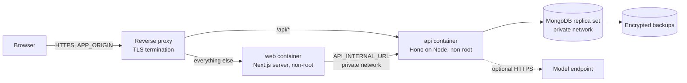

# Deployment Architecture

> **Status:** Proposed for production and **not verified**. The repository has no Dockerfile or container images, and no production deployment has been done. Backup and restore have not been rehearsed (NFR-016). Local development (Docker Compose MongoDB plus `npm run dev`) is in [local development](../engineering/local-development.md). Sections that mention images describe intended behaviour only.

## Environments

| Environment | Purpose | Database | AI |
| --- | --- | --- | --- |
| Local development | Contributors | MongoDB single-node replica set via Docker Compose | `none` or `mock` by default. Optionally a local or hosted OpenAI-compatible endpoint |
| Test / CI | Automated tests | Ephemeral MongoDB replica set (`mongodb-memory-server` replica-set mode, or Docker) | `mock` only. CI never calls a real model |
| Production (self-hosted) | Real use | MongoDB replica set (self-managed or a managed service) with backups | Operator choice, disabled by default |

## Topology (production)

There are two application containers (web, API) plus MongoDB, behind one reverse proxy that provides the single origin ([ADR-0013](adr/0013-web-api-communication.md)). Both apps are stateless, because sessions live in MongoDB, so they can be scaled horizontally later. That is not required for the MVP.

## Build and release

1. CI on `main`: lint → typecheck → unit → integration → build → container images (`apps/web` uses the Next.js standalone output, `apps/api` uses the compiled Node bundle).
2. Images are tagged with the semver release and the git SHA.
3. Release procedure:
   1. Back up the database.
   2. Run `npm run db:migrate` as a one-off job using the API image.
   3. Start the new API and check `/readyz`.
   4. Start the new web.
   5. Route traffic.
4. Rollback: redeploy the previous images. Migrations follow expand → migrate → contract, so the previous version stays compatible. A destructive migration needs a restore plan in its PR.

## Health checks

| Endpoint | Meaning |
| --- | --- |
| API `GET /healthz` | Process alive (no dependencies) |
| API `GET /readyz` | MongoDB reachable (`ping`), replica set primary available, migrations up to date. Returns 503 otherwise. AI is **not** included (optional) |
| Web | The proxy health-checks the Next.js server root. The web app does not report readiness for the API |

## Configuration

Environment variables per app. See [environment configuration](../engineering/environment-configuration.md).

## Logging and monitoring

- JSON logs go to stdout from both apps. The request ID is propagated from web to API (`X-Request-Id`).
- Minimum alerts: API 5xx rate, p95 latency, `/readyz` failures, AI failure rate (`aiGenerations.status`), MongoDB connection errors and replication health.

## Backups and recovery

- Nightly `mongodump --archive --gzip` (or provider snapshots) with 14-day retention, plus a pre-release backup.
- Rehearse a restore at least once per release with `mongorestore` into a scratch database. Verify document counts, run a smoke test, and record the result in the release notes (NFR-016).
- Recovery point objective (target): 24 hours. Recovery time objective (target): 2 hours. Both are targets, not guarantees.

## Costs (transparency)

The software is free. Operators may pay for servers, a managed MongoDB, a domain/TLS and any hosted model inference. AI is optional, and the app is fully functional with `AI_PROVIDER=none` (SC-8).
