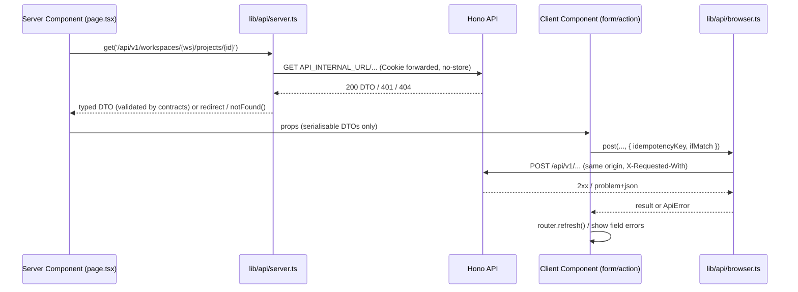

# Frontend Architecture

> **Status:** Implemented for M1–M5 (`apps/web`). Screens for unbuilt requirements (members FR-004, audit log FR-016, dashboard FR-017) are planned. [Implementation status](../quality/implementation-status.md) is the source of truth. Decisions: [ADR-0009 (Next.js App Router)](adr/0009-nextjs-app-router-frontend.md), [ADR-0013 (web-to-API communication)](adr/0013-web-api-communication.md).

## Principle

`apps/web` is a **presentation layer**. It renders data from the API, collects input, and calls the API. It never accesses MongoDB, never computes money or eligibility, never calls AI providers, and holds no secrets.

## Stack

| Concern | Choice |
| --- | --- |
| Framework | Next.js with the App Router, React, TypeScript strict |
| Server data | Server Components → `serverApi` (`lib/api/server.ts`, `import 'server-only'`) |
| Mutations | Client Components → `@soloops/api-client` (`lib/api/browser.ts`) → `router.refresh()` |
| Forms | React Hook Form + Zod resolver using `@soloops/contracts` schemas |
| Accessible primitives | Radix UI (dialog, dropdown, tabs, tooltip) |
| Styling | CSS Modules + CSS custom-property design tokens |
| A11y testing | `@axe-core/playwright`, `vitest-axe` |

There is no client-side data cache library in the MVP (ADR-0009). Add new libraries only with justification. Material additions need an ADR.

## Structure

```text
apps/web/src/
├── app/
│   ├── layout.tsx                    # html shell, fonts, providers (toasts, aria-live region)
│   ├── (public)/signin/page.tsx
│   ├── (public)/register/page.tsx
│   └── (app)/                        # protected group
│       ├── layout.tsx                # serverApi.get('/auth/me'); 401 → redirect('/signin?returnTo=…')
│       └── w/[workspaceId]/
│           ├── layout.tsx            # sidebar nav (Dashboard, Approvals, Clients, Projects, Billing, Settings); API 404 → notFound()
│           ├── page.tsx              # S-14 dashboard
│           ├── approvals/page.tsx    # S-15 approvals queue
│           ├── projects/page.tsx, projects/[projectId]/{page,requirements,change-requests,tasks,billing}/…
│           ├── clients/…, billing/page.tsx, billing/invoices/[invoiceId]/{page,print}/…
│           ├── settings/page.tsx, settings/audit/page.tsx
│           └── loading.tsx, error.tsx, not-found.tsx
├── features/<module>/                # client components, form hooks, view models
├── components/                       # StatusBadge, Money, ConfirmDialog, EmptyState, ErrorState
└── lib/
    ├── api/server.ts                 # 'server-only': base API_INTERNAL_URL, forwards Cookie + X-Request-Id, no-store
    ├── api/browser.ts                # createApiClient({ baseUrl: '' }) with CSRF header
    └── format/                       # Intl currency/date (en-IN default), minor-unit string display
```

**Routes:** every app route lives under `/w/[workspaceId]/…`, mirroring the API's `/api/v1/workspaces/:workspaceId/…`. The screen inventory is in [screen specifications](../design/screen-specifications.md#2-screen-inventory), and visual rules are in the [UI/UX design system](../design/ui-ux-design-system.md). The paths listed there sit under this prefix.

## Data flow



## Rules

1. **No caching of authenticated data.** Server fetches use `cache: 'no-store'`, and protected routes render dynamically. Never use `unstable_cache`, `fetch` revalidation or static generation for per-user data.
2. **No business operations in Server Actions or Route Handlers** (ADR-0009). All mutations go through the API.
3. **Serialisable props only** cross the server-to-client boundary. Amounts stay as minor-unit strings.
4. **Auth guard:** the protected layout calls `/auth/me`. The Next.js request-interception file (middleware/proxy, depending on version) may do an optimistic cookie-presence redirect for UX. The API remains the authority, and owner-only buttons are hidden only as a convenience.
5. **Idempotency keys:** `crypto.randomUUID()` once per user intent, reused for retries of that intent.

## Money and status display

`<Money minor="1200000" currency="INR" />` formats with `Intl.NumberFormat('en-IN', { style: 'currency' })` via `BigInt` parsing. **No arithmetic.** `<StatusBadge>` always renders text plus an icon (A11Y-004).

## Loading, empty and error states

- `loading.tsx` uses a skeleton with `aria-busy`.
- Empty views explain the situation and offer the next action.
- `error.tsx` shows a message, a retry and the request ID.
- `not-found.tsx` covers foreign or missing resources (API `404`).
- Client mutations map `409`/`412` to a reload banner and `422` to field errors.

## Forms

React Hook Form validates on blur and submit using the same Zod schemas as the API. An error summary links to fields (A11Y-003). Irreversible actions use `ConfirmDialog` with a summary of what will be frozen.

## Accessibility and responsiveness

WCAG 2.2 AA (A11Y-001…007). Use semantic HTML, label every input, use `aria-live="polite"` for async results, and respect `prefers-reduced-motion`. Layouts are fluid from 360 px, and tables become cards below 600 px.

## Testing

RTL for Client Components (forms, state-dependent actions, error mapping). Playwright for Server Component pages and journeys ([ADR-0014](adr/0014-testing-strategy-for-next-hono-mongodb.md)).
