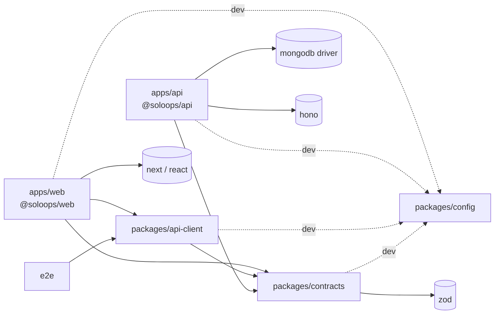

# Monorepo Structure

> **Status:** **Implemented in M1** (2026-10-16), plus an `e2e` workspace (`@soloops/e2e`). Pinned versions and tooling choices are in [ADR-0016](adr/0016-m1-implementation-choices.md). Decisions: [ADR-0009](adr/0009-nextjs-app-router-frontend.md), [ADR-0010](adr/0010-hono-api-on-node.md), [ADR-0011](adr/0011-monorepo-packages-and-contracts.md), [ADR-0012](adr/0012-mongodb-and-data-access.md), [ADR-0013](adr/0013-web-api-communication.md).

## Layout

```text
.
├── package.json                 # private root: npm workspaces ["apps/*", "packages/*"], orchestration scripts
├── package-lock.json            # single lockfile, committed
├── docker-compose.yml           # mongo (single-node replica set); optional api/web for prod-like runs
├── apps/
│   ├── web/                     # @soloops/web: Next.js App Router (presentation only)
│   │   ├── next.config.ts       # transpilePackages, rewrites /api → API_INTERNAL_URL (dev)
│   │   └── src/
│   │       ├── app/             # routes, layouts, loading/error boundaries
│   │       ├── features/        # per-module client components and form logic
│   │       ├── components/      # shared UI (StatusBadge, Money, ConfirmDialog…)
│   │       └── lib/             # api/server.ts ('server-only'), api/browser.ts, format/
│   └── api/                     # @soloops/api: Hono on Node (all business logic and data)
│       ├── migrations/          # versioned MongoDB migration scripts
│       └── src/
│           ├── main.ts          # wires real deps, starts @hono/node-server
│           ├── app.ts           # createApp(deps): Hono app (used by tests)
│           ├── platform/        # config, db, http middleware, logging, clock, ids, errors
│           └── modules/         # identity, workspace, core-ops, scope-guard, billing, ai, audit (planned, not built: community, dashboard)
├── packages/
│   ├── contracts/               # @soloops/contracts: Zod DTOs, enums, error codes, route paths (deps: zod)
│   ├── api-client/              # @soloops/api-client: typed fetch client (deps: @soloops/contracts)
│   └── config/                  # @soloops/config: tsconfig bases, ESLint flat config, Prettier
├── e2e/                         # Playwright tests (uses @soloops/api-client for setup)
├── scripts/                     # repo scripts (check-docs.mjs)
├── docs/
└── .claude/
```

## Workspace responsibilities

| Workspace | Owns | Must not contain |
| --- | --- | --- |
| `apps/web` | Pages, layouts, components, forms, formatting, UX states, calling the API | MongoDB access, business rules, money calculation, eligibility logic, AI calls, secrets |
| `apps/api` | HTTP API, authentication, workspace authorisation, business rules, transactions, money, eligibility, AI orchestration, audit, migrations | UI code |
| `packages/contracts` | Request/response Zod schemas, inferred types, enums (states, channels, reason codes), problem codes, route path helpers, minor-unit string parse/format | DB types, `mongodb`/`hono`/`next` imports, `node:*` built-ins, env access, business logic |
| `packages/api-client` | `createApiClient({ baseUrl, fetch, headers })`, CSRF header, idempotency-key option, `If-Match`, problem+json → `ApiError`, response validation | Server-only code, env access, caching |
| `packages/config` | Shared lint/type/format configuration, **boundary rules** | Runtime code |

## Dependency graph



Nothing points **into** `apps/*`. `mongodb` is reachable only from `apps/api`.

## Boundary enforcement

| Rule | Enforced by |
| --- | --- |
| Packages never import `apps/*`, `mongodb`, `hono`, `next`, or `node:*` | `package.json` dependencies plus ESLint `no-restricted-imports` in `@soloops/config` |
| `apps/web` never imports `mongodb` or `@soloops/api` | `@soloops/api` is not a dependency of web, plus an ESLint restriction |
| Only `apps/api/src/platform/db` imports `mongodb` | ESLint `import/no-restricted-paths` |
| API modules import each other only via `index.ts`. `ai` imports no domain module | ESLint `import/no-restricted-paths` |
| Server-only web helpers (`lib/api/server.ts`) are not bundled for the client | `import 'server-only'` at the top of the file |
| Contract changes compile in both apps | Root `npm run typecheck` runs across all workspaces |

These rules are verified by TC-ARCH-01 ([test plan](../quality/test-plan.md#e-architecture-and-e2e)).

## Root scripts (planned)

| Script | Does |
| --- | --- |
| `npm run dev` | Runs API and web in parallel (via `concurrently`, because npm workspaces run scripts sequentially) |
| `npm run build` | `npm run build --workspaces --if-present` |
| `npm run lint` / `npm run typecheck` | Across all workspaces |
| `npm test` | Unit, component and integration tests (needs a MongoDB replica set) |
| `npm run test:e2e` | Playwright |
| `npm run validate` | lint + typecheck + test + build |
| `npm run db:migrate` | `npm run migrate -w @soloops/api` |
| `npm run docs:check` | `node scripts/check-docs.mjs` |
| `npm run design:contrast` | `node scripts/check-contrast.mjs` (colour tokens vs WCAG AA) |

## Versions

Node.js 22 LTS (`.nvmrc`; `engines` ≥ 22.12). Exact versions are pinned in each `package.json` and listed in [ADR-0016](adr/0016-m1-implementation-choices.md). The API is bundled with esbuild (`apps/api/build.mjs`).

## Related

- [Architecture overview](architecture-overview.md)
- [Local development](../engineering/local-development.md)
- [Environment configuration](../engineering/environment-configuration.md)
