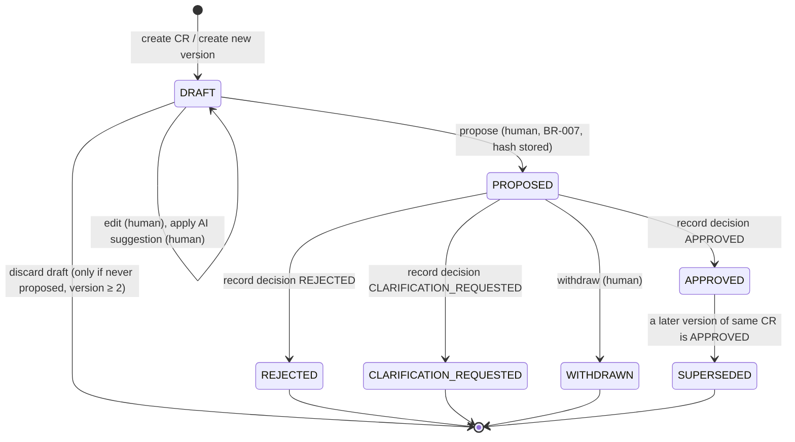

# Change-Request Lifecycle

This document is authoritative for change-request (CR) and CR-version states. It implements [BR-006 – BR-014](../product/business-rules.md#change-requests-and-approvals).

## Concepts

- A **change request** is the client's ask, for example "add WhatsApp login". It owns an ordered list of **versions**.
- A **version** is one complete proposal: description, scope, acceptance criteria, assumptions, estimate, price and timeline impact. Versions are numbered 1, 2, 3 … per CR.
- A **decision** is the client's recorded response to one *proposed* version. It is bound to that version's content hash.
- The **authorised version** of a CR is its single version in state `APPROVED`, if any.

## Version state machine

### Transition table

| From | Action | To | Preconditions | Side effects (same transaction) |
| --- | --- | --- | --- | --- |
| — | Create CR | `DRAFT` v1 | Project active (BR-029) | Audit `cr.created` |
| `DRAFT` | Edit | `DRAFT` | `If-Match` row version matches | `rowVersion++` |
| `DRAFT` | Propose | `PROPOSED` | BR-007 completeness; price computed (BR-020/021) | Canonical JSON → SHA-256 stored; audit `cr.version.proposed` |
| `PROPOSED` | Record decision | `APPROVED` / `REJECTED` / `CLARIFICATION_REQUESTED` | Version is the CR's current `PROPOSED` one; hash matches; date ≤ now | Insert immutable `ApprovalRecord`; if `APPROVED`, previous `APPROVED` → `SUPERSEDED`; audit `cr.decision.recorded` |
| `PROPOSED` | Withdraw | `WITHDRAWN` | — | Audit `cr.version.withdrawn` |
| any closed state | Create new version | new `DRAFT` (n+1) | No open version exists (BR-009) | Content copied from latest version; audit `cr.version.created` |
| `APPROVED` | Convert to tasks | (unchanged) | State is exactly `APPROVED` | Tasks created linked to version; audit `cr.tasks.created` |

Any transition not in this table is rejected with `409 INVALID_STATE_TRANSITION`.

**What the AI can do:** the AI can only produce a *suggestion* for a `DRAFT` version. Applying it is a human `Edit`. No AI pathway reaches `Propose`, `Record decision` or `Convert` ([BR-001](../product/business-rules.md#ai-boundaries), [BR-002](../product/business-rules.md#ai-boundaries)).

## Derived CR status (for lists and filters)

CR status is **derived** from the versions by the pure function `deriveCrStatus(versions)`. It is cached as `derivedStatus` on the CR document, and that cache is written only in the same atomic update that changes version states, so it cannot drift ([ADR-0015](../architecture/adr/0015-cached-derived-cr-status.md)):

| Condition (evaluated in order) | Derived CR status |
| --- | --- |
| Open `DRAFT` version and an `APPROVED` version exists | `REVISING` (prior approval still authorises its own scope) |
| Open `DRAFT` version, no approved version | `DRAFT` |
| `PROPOSED` version exists | `AWAITING_DECISION` |
| Latest version `CLARIFICATION_REQUESTED` | `NEEDS_REVISION` |
| An `APPROVED` version exists | `APPROVED` |
| Latest version `REJECTED` | `REJECTED` |
| Latest version `WITHDRAWN` | `WITHDRAWN` |

## Worked examples

1. **Happy path:** v1 `DRAFT` → `PROPOSED` → `APPROVED` → tasks created → work logged → invoiced.
2. **Clarification:** v1 `PROPOSED` → `CLARIFICATION_REQUESTED` → v2 `DRAFT` (copied from v1, edited) → `PROPOSED` → `APPROVED`.
3. **Scope grows after approval:** v1 `APPROVED`, 6 h logged. The client asks for more → v2 `DRAFT` (CR status `REVISING`; the 6 h stay eligible under v1) → v2 `APPROVED` → v1 `SUPERSEDED`. New tasks are created from v2.
4. **Expansion rejected:** v1 `APPROVED`, v2 `REJECTED` → v1 remains the authorised version. Work linked to v2 is impossible because tasks can only be converted from `APPROVED`. Entries linked directly to v2 are ineligible (`CR_NOT_APPROVED`).

## Content hash

- Canonical JSON uses sorted keys, no insignificant whitespace, and amounts as integers. It covers: title, clarified description, in-scope, out-of-scope, acceptance criteria, affected requirement IDs, dependencies, assumptions, **risks**, effort range, confirmed effort minutes, pricing mode, rate, price, **currency**, timeline impact, and the version number and CR ID. Risks and currency were added in M3 so that every field shown to the client is bound ([ADR-0018](../architecture/adr/0018-m3-scope-guard-and-ai-implementation-choices.md) §3). Implemented in `apps/api/src/modules/scope-guard/domain/version-rules.ts`.
- The hash is shown (abbreviated) on the proposal summary, so client and freelancer can refer to the exact version ("approved proposal v2 · `3f9a…c1`").
- The UI sends the hash with the decision request, which proves the user was looking at the same content (BR-010).
