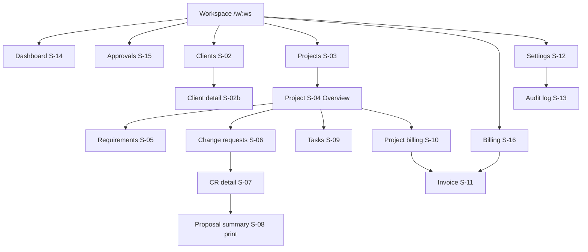

# Screen Specifications

> **Status:** Screens for M1–M5 are built (`apps/web`); deviations are listed in [known limitations](../quality/known-limitations.md). Screens for unbuilt requirements (S-13 audit log, S-14 dashboard, members) are planned. Visual tokens and components come from the [UI/UX design system](ui-ux-design-system.md). Routes follow [frontend architecture](../architecture/frontend-architecture.md#structure). Behaviour rules come from [business rules](../product/business-rules.md) and the [change-request lifecycle](../design/change-request-lifecycle.md). Wireframes are textual so any contributor can implement them with the design-system components.

## 1. Information architecture

The global navigation stays small. Requirements, change requests and tasks always belong to a project, so they live as **project tabs**, not as empty global screens. Approvals and Billing are global because they answer cross-project questions ("what's waiting on clients?", "what can I invoice?").



| Requested section | Where it lives | Why |
| --- | --- | --- |
| Dashboard | Global (S-14) | Daily starting point |
| Clients | Global (S-02) | Clients span projects |
| Projects | Global list (S-03), detail with tabs (S-04) | Main work container |
| Requirements | Project tab (S-05) | Always project-scoped. A global list would mix unrelated scopes |
| Tasks | Project tab (S-09) | Same. "My tasks" across projects is post-MVP |
| Change requests | Project tab (S-06) and cross-project queue (S-15) | Created in a project context. Tracked across projects |
| Approvals | Global (S-15) | Queue of CRs awaiting or needing client decisions (FR-032) |
| Billing and invoices | Global (S-16) and project tab (S-10) | Invoices list globally. Unbilled work per project |
| Settings | Global (S-12), with members, AI and the audit log (S-13) | Rarely used, so kept at the bottom of the nav |

**Sidebar order:** workspace switcher · Dashboard · Approvals (pending count) · Clients · Projects · Billing · (spacer) · Settings · user menu (theme, sign out).

## 2. Screen inventory

All routes except S-01 are prefixed with `/w/[workspaceId]`.

| ID | Screen | Route | Requirements |
| --- | --- | --- | --- |
| S-01 | Sign in / Register | `/signin`, `/register` | FR-001, FR-002 |
| S-02 | Clients list / client detail | `/clients`, `/clients/[clientId]` | FR-010 |
| S-03 | Projects list | `/projects` | FR-011 |
| S-04 | Project overview | `/projects/[projectId]` | FR-015 |
| S-05 | Requirements and baselines | `/projects/[projectId]/requirements` | FR-012, FR-013 |
| S-06 | Change requests (project) and create | `/projects/[projectId]/change-requests`, `…/new` | FR-020, FR-028 |
| S-07 | Change request detail (versions, AI, decision) | `/projects/[projectId]/change-requests/[crId]` | FR-021–030 |
| S-08 | Proposal summary (client-facing, print) | `…/[crId]/versions/[n]/summary` | FR-027 |
| S-09 | Tasks | `/projects/[projectId]/tasks` | FR-014, FR-030 |
| S-10 | Project billing (unbilled work) | `/projects/[projectId]/billing` | FR-040, FR-041 |
| S-11 | Invoice draft / review / print | `/billing/invoices/[invoiceId]`, `…/print` | FR-042–046 |
| S-12 | Settings (workspace, members, AI) | `/settings` | FR-004, FR-005, FR-054 |
| S-13 | Audit log | `/settings/audit` | FR-016 |
| S-14 | Dashboard | `/` (workspace root) | FR-017 |
| S-15 | Approvals queue | `/approvals` | FR-032 |
| S-16 | Billing (invoices and unbilled by project) | `/billing` | FR-041, FR-042 |

## 3. Shared state patterns

Every data screen implements these states with the [design-system components](ui-ux-design-system.md#713-notifications-and-errors):

| State | Pattern |
| --- | --- |
| Loading | Skeleton in the final layout shape. `aria-busy` on the region. The page header renders immediately if known |
| Empty | EmptyState with a one-line explanation and the next action |
| Success | Toast for L1/L2 actions. Inline confirmation and `aria-live` for L3/L4. The page refreshes via `router.refresh()` |
| Error (load) | ErrorState with Retry and request ID. `404` → not-found page ("This item doesn't exist or isn't in this workspace") |
| Validation | Field errors plus a focused ErrorSummary on submit (`422`) |
| Conflict | Banner "This item changed since you opened it" with Reload (`409`/`412`) |
| Permission denied | PermissionNotice explaining who can act (`403`, or a member viewing owner-only actions) |
| Session expired | Redirect to sign-in with `returnTo`. In-memory form data is kept where possible |
| Read-only (archived) | Banner "Archived — read-only" with actions hidden |

## 4. Screens

### S-14 Dashboard

**Purpose:** answer "what needs me today?" in under 10 seconds.

```text
┌ Dashboard ──────────────────────────────────────────────── [+ New change request ▾] ┐
│ ┌ Awaiting client ─┐ ┌ Needs revision ┐ ┌ Ready to invoice ──┐ ┌ Not billable ─┐       │
│ │ 3 CRs · ₹41,000  │ │ 1 CR           │ │ ₹62,500 · 2 projects│ │ 4 entries     │      │
│ └──────────────────┘ └────────────────┘ └────────────────────┘ └───────────────┘       │
│ Waiting on clients                                              [View all approvals →]│
│  ⏳ CR-3 v2 WhatsApp OTP login · Online ordering app · ₹13,500 · 4 days               │
│  ⏳ CR-1 v1 Export to Excel · Inventory portal · ₹8,000 · 1 day                        │
│ Ready to invoice by project                                                            │
│  Online ordering app (Das Sweets)   ₹45,000 eligible · 2 not billable   [Review →]    │
│ Recent decisions                         Draft invoices                                 │
│  ✓ CR-3 v2 approved · 14 Oct · Email      RS-draft · Das Sweets · ₹29,500 [Open]     │
└────────────────────────────────────────────────────────────────────────────────────────┘
```

- **Hierarchy:** 4 StatTiles → waiting on clients (oldest pressure first is a secondary sort option) → unbilled per project → recent decisions and draft invoices.
- **Primary action:** "New change request" (asks for a project first). Secondary: open the approvals queue, review billing.
- **States:**
  - Empty (new workspace): a **setup checklist** replaces the tiles (AC-026.3): ① Add client ② Create project ③ Record requirements ④ Baseline scope ⑤ (Optional) Enable AI.
  - Loading: tile and list skeletons.
  - Error: per-section ErrorState, so a single failed widget doesn't blank the page.
  - Permission: none (all members).
- **Acceptance:** AC-026.1–.4.

### S-02 Clients list and client detail

```text
Clients                                              [+ Add client]
[Search clients…]  [Active ▾]
Name               Contact     Projects  Unbilled (eligible)
Das Sweets Pvt Ltd S. Das      2         ₹45,000
```

- **List:** a table (cards on mobile) with a name link. The "Archived" filter is off by default. Primary action: **Add client** (a dialog with name required and the other fields optional).
- **Detail:**
  - header: name, contact, archive action in the overflow menu
  - sections: Contact and billing details (edit inline as a form), Projects (list plus "New project"), Recent change requests, Invoices
- **States:**
  - empty list: "Add your first client to start a project"
  - archived client: read-only banner, "New project" hidden (AC-005.2)
  - foreign or missing ID: the not-found page (AC-004.2)
  - validation: name required, email format

### S-04 Project overview

```text
Online ordering app · Das Sweets          [ACTIVE]  Hourly · ₹1,500/h · INR   [⋯]
Overview | Requirements | Change requests | Tasks | Billing
┌ Scope ─────────────────────────────────────────────────────────────────────┐
│ ▣ Original scope  Baseline 1 · 5 requirements · frozen 3 Oct  [View]       │
│ ⊞ Additional      2 approved CRs · ₹21,500   1 awaiting · ₹8,000           │
│ ✓ Authorised work 5 requirements + 2 CRs                                   │
└────────────────────────────────────────────────────────────────────────────┘
┌ Tasks ───────────┐ ┌ Billing ─────────────────────────────┐
│ 4 to do · 3 in   │ │ ₹45,000 ready to invoice · 2 not     │
│ progress · 9 done│ │ billable  [Review unbilled work →]   │
└──────────────────┘ └──────────────────────────────────────┘
```

- **Scope card (key element):** three lines that always answer *what is original*, *what is additional (and its approval state)*, and *what is authorised*. It uses ScopeTag colours and icons.
- **Primary action:** contextual. "Baseline scope" if not baselined, otherwise "New change request".
- **States:**
  - not baselined: a warning InlineAlert "No baseline yet — work can't be invoiced until original scope is baselined" with a CTA
  - archived: read-only banner
  - loading: skeleton cards
- **Acceptance:** AC-024.1.

### S-05 Requirements and baselines

```text
Requirements                         [+ Add requirement] [Baseline scope…]
Draft (not yet agreed) — 2                          editable
  REQ-6  Push notifications   SHOULD   [Edit] [Delete]
Original scope · Baseline 1 · 3 Oct · hash 5c1e…   🔒 frozen
  REQ-1  Menu browsing        MUST
  REQ-2  Customer login       MUST
```

- Draft requirements are grouped above frozen baselines. Each baseline group shows its sequence, date, short hash and a lock icon.
- **Add/edit:** a side drawer with title, description, acceptance criteria (a repeatable list), priority.
- **Baseline scope…** (L2 dialog): "Freeze 2 requirements as Baseline 2. They can't be edited afterwards; changes will need a change request."
- **States:**
  - empty: "Record what the client asked for originally" with Add
  - editing a frozen requirement: not offered. The tooltip explains, with a link "Create change request" (AC-007.2)
  - baseline with nothing to freeze: the button is disabled with an explanation (AC-007.3)
  - validation: title required, ≤ 200

### S-09 Tasks

- **List** (MVP; a board is post-MVP) grouped by status, with filters for assignee and scope.
- **Columns:** title, ScopeTag (Original · REQ-2 / Additional · CR-3 v2 / Internal), assignee, billable icon, status select.
- **Create:** a drawer. A billable task must pick a scope from a combobox listing **only** baselined requirements and approved CR versions (BR-015). Internal tasks are non-billable.
- **Log time** inline from a task row (DurationInput, date, description) creates a billable entry with the task's scope.
- **States:**
  - empty: "Tasks come from baselined requirements or approved change requests" with links
  - an attempt to make an unscoped task billable: field error (AC-016.1)
  - assignee not a member: a validation error

### S-06 Change requests (project list and create)

```text
Change requests                                            [+ Record change request]
[All ▾] [Awaiting decision] [Needs revision] [Approved] [Rejected]
CR-3  WhatsApp OTP login     v2 ✓ Approved            ₹13,500  14 Oct
CR-4  Export orders to Excel v1 ⏳ Awaiting decision   ₹8,000   4 days
```

- **Record change request** (page `…/new`, not a dialog, because the text can be long):
  1. *As received*: raw request text (large textarea, ≤ 20,000, a "paste the client's message exactly" hint), channel, requested by, received date (≤ today).
  2. A title (optional; it defaults from the first line).
  3. Submit creates CR-n with draft v1 and lands on S-07, where **Analyse with AI** is offered.
- **States:**
  - archived project: creation hidden (AC-008.2)
  - validation errors listed in the ErrorSummary
  - empty: "No extra requests yet. When the client asks for something new, record it here instead of just saying yes."

### S-07 Change request detail (core screen)

The layout answers five questions at a glance: **what's original, what's additional, how much, is approval pending, what's authorised.**

```text
Projects / Online ordering app / CR-4                                   [⋯]
CR-4 · Export orders to Excel                 ⏳ AWAITING CLIENT DECISION
Received 15 Oct via CHAT from "S. Das"   ▸ Original message (verbatim)
┌ Scope strip ───────────────────────────────────────────────────────────────────┐
│ ▣ Affects original scope: REQ-4 Order history                                  │
│ ⊞ Additional: v1 · 3 acceptance criteria · Est. 4–6–9 h · Price ₹8,000         │
│ ⏳ Approval: proposed 15 Oct, waiting 1 day · hash 9b2e…                        │
│ ⛔ Authorised work: none yet — tasks and billing unlock after approval         │
└────────────────────────────────────────────────────────────────────────────────┘
Versions: [v1 ⏳ Proposed]                                    [Compare versions]
┌ Proposal v1 (frozen 🔒) ───────────────────────┐ ┌ Next step ──────────────────────┐
│ Description                                    │ │ Share the proposal with the      │
│ In scope · Out of scope                        │ │ client, then record their reply. │
│ Acceptance criteria                            │ │ [View client summary]            │
│ Assumptions · Dependencies · Risks             │ │ [Record client decision]  ◀ primary│
│ Effort 4–6–9 h · confirmed 5 h 20 min          │ │ [Withdraw proposal]              │
│ Price ₹8,000 (5 h 20 min × ₹1,500/h)            │ └──────────────────────────────────┘
│ ⓘ Estimate, not a guarantee…                   │
└────────────────────────────────────────────────┘
History (ApprovalTimeline + audit)
```

**Scope strip.** Always present. Each line uses the scope or state tone with icon and text:

| Line | Content by state |
| --- | --- |
| Affects original scope | Linked requirements (ScopeTags), or "No existing requirement affected" |
| Additional | Current version number, acceptance-criteria count, effort range, price (server-computed) |
| Approval | Draft: "Not sent". Proposed: "Waiting N days". Approved: "Approved 14 Oct by S. Das via Email". Rejected / clarification: who, when |
| Authorised work | "None yet" (pending tone) / "v2 authorised · 3 tasks · ₹6,000 logged" (success) / "v1 remains authorised; v2 pending" (REVISING) |

**Right panel ("Next step") by state.** Exactly one primary action per state:

| Version state | Primary action | Secondary |
| --- | --- | --- |
| `DRAFT` | **Propose to client…** (L2) | Analyse with AI, Save, Discard draft |
| `PROPOSED` | **Record client decision…** (L3) | View client summary, Withdraw |
| `APPROVED` | **Create tasks from this version…** | View client summary, Start revision |
| `CLARIFICATION_REQUESTED` / `REJECTED` / `WITHDRAWN` | **Create new version** | — |
| `SUPERSEDED` (viewing an old version) | Go to current version | — |

**Draft editing (DRAFT only):**
- Form sections mirror the proposal: description, scope lists, acceptance criteria, affected requirements (a combobox of project requirements), dependencies, assumptions (≥ 1 required to propose), risks, effort range, confirmed effort, pricing mode (Time or Fixed), timeline impact.
- The price preview is shown as "calculated on save". The server returns the price on save and propose, and the UI never computes it (BR-020).
- AI panel: see below.

**AI-generated estimate review (part of S-07, DRAFT only):**
- On `md+`, the [AI suggestion panel](ui-ux-design-system.md#711-ai-suggestion-panel) sits to the right of the form. On mobile it is an accordion above the form.
- The user applies fields individually or all at once. Applied fields get the `AI-suggested` badge until edited. The effort range never auto-fills **confirmed effort**: the human must enter it (BR-003).
- The indicative cost appears only in the panel, labelled "indicative".
- **States:** idle, running (Cancel), success, failure (manual fallback message), disabled for the workspace (panel hidden; owners see "Enable AI in Settings"), rate-limited ("Try again in N minutes").

**Propose dialog (L2):** a summary of price, effort, assumptions count and acceptance-criteria count, plus "After proposing, v1 is frozen. Any change will need a new version and a new client decision." Missing fields → `422`, and the ErrorSummary lists them (AC-011.1).

**Client approval interface: Record client decision dialog (L3).** Clients do not log in ([OQ-003](../product/open-questions.md)), so this dialog is how the freelancer records the client's reply:

```text
Record client decision — CR-4 v1 · hash 9b2e…c7
Decision            (•) Approved  ( ) Rejected  ( ) Client asked for changes
Client decision-maker   [S. Das            ]
Decision date           [2026-10-16] (today or earlier)
Channel                 [Email ▾]
Evidence (recommended)  [Email "Re: Proposal CR-4" 16 Oct 11:02          ]
[✓] I confirm the client made this decision on the proposal above.
                                   [Cancel]  [Record approval]
```

- The confirm label follows the decision ("Record approval", "Record rejection", "Record change request").
- **On success:** an `aria-live` announcement, the scope strip updates, and for Approved the primary action becomes "Create tasks".
- **Errors:**
  - `409 VERSION_HASH_MISMATCH` or a state conflict: banner "This proposal changed or was already decided — reload" (AC-012.2–.4)
  - future date: field error (AC-012.5)

**Version compare:** [VersionCompare](ui-ux-design-system.md#79-change-request-comparison-versioncompare), any two versions, with the price/effort delta row on top.

**Permission:** all members can act on CRs. On an archived project the screen is read-only.

**Acceptance:** AC-009.1–.6, AC-010.1–.3, AC-011.1–.3, AC-012.1–.6, AC-013.1–.3, AC-014.1–.2, AC-015.1–.2.

### S-08 Proposal summary (client-facing, print)

- A clean, light-mode-only page designed to be printed to PDF or copied as plain text (a "Copy as text" button).
- **Contents:**
  - header with workspace billing details and client name
  - "Change request CR-4 · Proposal v1 · 15 Oct 2026 · Ref 9b2e…c7"
  - Summary, What's included, Not included, Acceptance criteria, Assumptions, Price, Timeline impact
  - estimate disclaimer
  - "How to respond: reply to approve, reject or ask questions, quoting the reference above"
- A draft version shows a "DRAFT — not yet proposed" watermark.

### S-15 Approvals queue

```text
Approvals                                    [Awaiting decision ▾] [All projects ▾]
CR     Title                      Project               Version  Price     Waiting
CR-4   Export orders to Excel     Online ordering app   v1 ⏳    ₹8,000    1 day
CR-7   Loyalty points             Inventory portal      v2 ⚠     ₹22,000   6 days
                                                                 [Load more]
```

- Default filter: Awaiting decision, oldest waiting first. A row opens S-07 at the open version (AC-027.2).
- The nav count badge shows the number awaiting decision.
- **States:** empty, "Nothing is waiting on clients 🎉" (text only, no illustration); loading; error.

### S-10 Project billing (unbilled work)

```text
Billing · Online ordering app                       [Log work] [Create invoice draft]
Ready to invoice (5) ····································· Total ₹45,000
 ☐ 15 Oct  OTP verification endpoint  ⊞ CR-3 v2   2 h 00 × ₹1,500 = ₹3,000
 ☐ 10 Oct  Login API                  ▣ REQ-2     4 h 00 × ₹1,500 = ₹6,000
Not billable yet (2)
 ⚠ 16 Oct  Excel export spike    ⊞ CR-4 v1 — not approved yet (CR_NOT_APPROVED) [Open CR]
 ⚠ 11 Oct  Misc fixes            — not linked to agreed scope (UNSCOPED)         [Link…]
Invoices for this project: RS-0007 Issued ₹2,950 · RS-draft Draft ₹29,500
```

- Eligible and ineligible sections come **exactly** from the server classification (AC-018.2). Each ineligible row shows a reason and a fix action.
- Selecting rows enables **Create invoice draft** (primary), which shows the selected count and total from the server.
- **Log work:** a drawer with kind (Time/Fixed), date, duration or amount, description, and a task or scope picker.
- **States:**
  - empty: "No unbilled work. Log time from a task or here."
  - all ineligible: a warning InlineAlert explaining that nothing can be invoiced until scope is baselined or CRs are approved
  - entry already invoiced: edit is hidden (AC-017.3)

### S-16 Billing (workspace)

- Tabs: **Invoices** (list with status filter, number, client, project, total, issued date) and **Unbilled by project** (project, eligible total, not-billable count, link to S-10).
- Primary: "Create invoice draft" (asks for a project, then goes to S-10 with selection mode).
- **States:**
  - empty invoices: "No invoices yet"
  - member view: everything is visible, and issue/void appear only on S-11 with a PermissionNotice

### S-11 Invoice draft, review and print

```text
Invoice draft · Das Sweets · Online ordering app        DRAFT        [⋯ Delete draft]
Lines                                                   [+ Adjustment]
 1  ⊞ CR-3 v2  OTP verification endpoint   2 h 00   ₹1,500/h    ₹3,000
 2  ▣ REQ-2    Login API                    4 h 00   ₹1,500/h    ₹6,000
 3  Manual     Goodwill discount  (reason: agreed on call)       −₹500
                                         Subtotal              ₹8,500
                                         GST 18%               ₹1,530
                                         Total                ₹10,030
SoloOps AI does not verify tax compliance. Review before sending.
                          [Preview print]   [Issue invoice RS-0008…]  ◀ owner only
```

- **Draft:** line description edit, remove line (releases the entry), add adjustment (amount and **reason** required, BR-025). Totals refresh from the server after each change. There is no client-side math.
- **Issue invoice… (L4):** "This assigns number RS-0008 and the invoice can no longer be edited. Total ₹10,030." Checkbox "I have reviewed this invoice." On success: `aria-live` "Invoice RS-0008 issued". Idempotent on retry (AC-020.3).
- **Issued:** read-only, number shown, Print, Void… (owner, L4 danger with a reason).
- **Void:** "RS-0008 will be marked void. Its number is not reused. 2 entries return to unbilled work."
- **States:**
  - member: the Issue button is replaced by a PermissionNotice "Only owners can issue invoices" (AC-020.2)
  - a line became ineligible: issue is blocked (`409`) with the offending lines highlighted and reasons shown (AC-020.4)
  - validation: an adjustment without a reason gets a field error (AC-019.3)
  - print: light mode, a DRAFT watermark for drafts (AC-020.5)

### S-12 Settings and S-13 Audit log

- **Workspace (owner):** name, billing details, currency, default rate, tax label and rate, invoice prefix, time zone. Members see it read-only with a PermissionNotice.
- **Members (owner, FR-004 Should):** list, add by email, remove. The last owner can't be removed.
- **AI (owner):** the provider status (from `/ai/status`) and an enable toggle with a disclosure dialog listing exactly what is sent (FR-054). Disabled if the server has no provider configured, with the explanation "Your administrator hasn't configured an AI endpoint".
- **Audit log (S-13):** AuditHistory with entity-type filter and Load more.

### S-01 Sign in / Register

Single-column card, email and password, generic errors (AC-001.2/.3), a password rule shown upfront (12+ characters), and a "Create workspace" step (workspace name) after registration.

## 5. Responsive behaviour summary

| Breakpoint | Behaviour |
| --- | --- |
| < 600 px | Tables become cards. Stat tiles become a 2×2 grid. Primary action sticks to the bottom of the screen on detail pages |
| < 768 px | S-07 panels stack: scope strip → next step → proposal → AI accordion. Dialogs go full-screen |
| < 1024 px | The sidebar collapses into a drawer |
| ≥ 1280 px | Content max-width 1200 px, centred |

## 6. UX acceptance criteria (design-level)

These complement the functional ACs and are verified in component and E2E tests (TC-E2E-03 and per-screen axe checks, planned):
- **UX-01:** On S-07, the scope strip shows original-scope impact, the additional-scope price, the approval state and the authorised-work state for every version state, without scrolling at 1280×800.
- **UX-02:** Every screen has exactly one primary button per state.
- **UX-03:** Every L2–L4 action opens a confirmation dialog that names the consequence. L3/L4 require an explicit checkbox.
- **UX-04:** No AI-originated content appears outside the AI panel without the `AI-suggested` badge.
- **UX-05:** Every ineligible entry and every disabled action shows its reason.
- **UX-06:** All states in §3 are implemented for each data screen.
