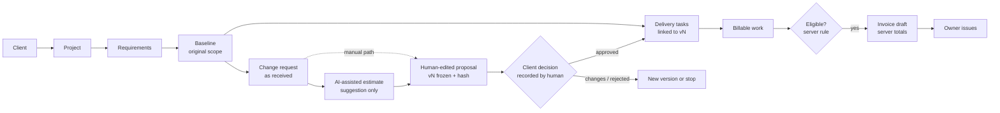
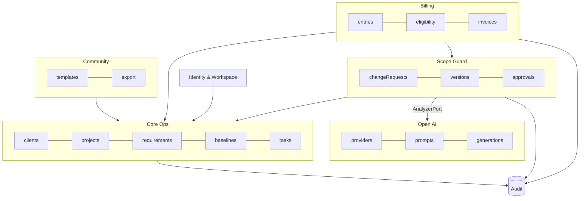
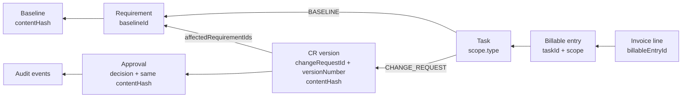

# Solution Design

This document explains how SoloOps AI solves the problem described in the [product overview](../product/product-overview.md). For implementation structure, see the [architecture overview](../architecture/architecture-overview.md).

> **Status:** Design, implemented for milestones M1–M5. Requirements that are not built (for example FR-004, FR-016, FR-017, FR-060–FR-062) remain design only. See [implementation status](../quality/implementation-status.md).

## 1. Problem → solution

| Problem | Solution mechanism |
| --- | --- |
| Requirements are scattered and ambiguous | Requirements are recorded with acceptance criteria and **baselined** (frozen, hashed) as the agreed original scope |
| Extra work is done without approval | Every extra ask is a **change request**. Work becomes billable and taskable only after a recorded `APPROVED` decision on a frozen version |
| "That's not what I approved" disputes | Decisions are bound to a **content hash**, with client name, date, channel and evidence, plus an append-only audit trail and version diffs |
| Vague asks are hard to estimate | **AI drafts** a clarified proposal (scope, acceptance criteria, assumptions, effort range, risks), and the human edits and confirms it |
| Forgotten billable work | **Unbilled work** view with eligibility reasons, and invoice drafts generated from eligible entries |
| Invoice mistakes | **Deterministic, server-side** integer arithmetic, plus an owner-only, idempotent issuing step |

## 2. Users, permissions and journeys

Personas (P1 solo freelancer, P2 team lead, P3 team member, P4 client as indirect stakeholder, P5 self-hoster), the permissions matrix and journeys J1–J5 are defined once in [personas and user journeys](../product/personas-and-user-journeys.md#permissions-summary-mvp). The MVP has two roles, `OWNER` and `MEMBER`. Clients are not system users ([OQ-003](../product/open-questions.md)). Screen-by-screen user flows UF-1…UF-5 are in [workflows, part B](workflows.md#part-b--user-flows).

### End-to-end MVP workflow

### Human approval versus automation

AI is advisory. It never authorises work, approves changes or calculates authoritative totals. The full step-by-step table is in [workflows → human decisions versus automation](workflows.md#human-decisions-versus-automation). In short:
- **Human only:** propose a version, record a client decision, issue or void an invoice, enable AI.
- **Application (deterministic):** price, eligibility, totals, numbering, status derivation, audit.
- **AI (suggestion):** clarified description, scope, acceptance criteria, assumptions, risks, effort range, client questions.

## 3. Module boundaries (functional)

Arrows mean "depends on". The **Open AI module depends on no domain module**, and no module grants it write access ([BR-001](../product/business-rules.md#ai-boundaries)).

## 4. Core entities and traceability

The entities are clients, projects, requirements, baselines, change requests (with embedded versions), approvals, tasks, billable entries, invoices (with embedded lines), AI generations and audit events, all scoped to a workspace. The collections, JSON examples and data dictionary are in the [data model](../architecture/data-model.md).

### How traceability is kept

Every billable item can be walked back to an agreed scope and a decision through stored references:

| Question | Answered by |
| --- | --- |
| Was this invoice line agreed? | line → entry → `scope` → baselined requirement **or** approved CR version + approval record |
| What exactly did the client approve? | `approvals.contentHash` = `versions[n].contentHash`, plus the frozen version content |
| Which original requirements did the change touch? | `versions[n].affectedRequirementIds` |
| What work was done under a CR? | tasks and entries indexed by `scope.changeRequestId + versionNumber` |
| Who did what, when? | `auditEvents` per entity (append-only) |

Eligibility is evaluated from these links **at draft creation and again at issue**, so a later change in authorisation can never slip through (BR-016, BR-017).

## 5. Features

Each feature answers: problem, users, inputs/outputs, rules, errors, tests and exclusions.

### 5.1 Scope baseline (FR-012, FR-013)

1. **Problem:** There is no agreed reference for "original scope".
2. **Users:** Owner and members.
3. **Inputs:** draft requirements. **Outputs:** a baseline record (sequence, requirement count, content hash) and requirements frozen in place.
4. **Rules:** BR-004, BR-005, BR-028.
5. **Errors:** nothing to baseline → `422`; editing a frozen requirement → `409`.
6. **Tests:** unit (hash stability), integration (freeze and audit atomicity), E2E (part of J1).
7. **Excluded:** client sign-off of the baseline itself (record it via a note for now); requirement-level versioning.

### 5.2 Change request capture (FR-020)

1. **Problem:** Asks arrive informally and get lost.
2. **Users:** Owner and members.
3. **Inputs:** raw text, channel, requested-by, received date. **Outputs:** a CR with draft v1.
4. **Rules:** BR-029. The raw text is stored verbatim and never edited (it is evidence).
5. **Errors:** archived project → `409`; text > 20,000 chars → `422`.
6. **Tests:** integration, validation boundaries.
7. **Excluded:** email or chat intake integrations.

### 5.3 AI-assisted proposal (FR-021, FR-022, FR-051–054)

1. **Problem:** Turning "can you add X?" into a clear, priced proposal takes time and is easy to do poorly.
2. **Users:** Owner and members, in workspaces where the owner enabled AI.
3. **Inputs:** CR raw text, project name and description, and the list of requirements (key, title, short description). The input is size-limited. **Outputs:** a suggestion following the [output schema](../architecture/ai-architecture.md#4-structured-output-schema), plus a generation record.
4. **Rules:** BR-001–003, BR-026, BR-027. The suggestion is shown side by side with the draft and applied by a human, per field or entirely.
5. **Errors:** ERR-001–003 (timeout, invalid output, unknown keys). AI disabled → `409 AI_DISABLED`. Rate limited → `429`.
6. **Tests:** unit (schema mapping, key filtering), integration with the `mock` provider (success, timeout, invalid JSON, injection text), offline evaluation set for model quality.
7. **Excluded:** chat-style conversation, auto-apply, model fine-tuning, embeddings and retrieval.

### 5.4 Proposal, pricing and freeze (FR-023, FR-024, FR-027)

1. **Problem:** Clients approve vague things, and terms then change silently.
2. **Users:** Owner and members.
3. **Inputs:** an edited draft, pricing mode (`FIXED` amount or `TIME` with confirmed minutes and the resolved rate), and timeline impact. **Outputs:** a `PROPOSED` immutable version with a hash, and a client-facing summary.
4. **Rules:** BR-006–009, BR-019–021, BR-026.
5. **Errors:** incomplete → `422` with a missing-field list; stale edit → `412`; not draft → `409`.
6. **Tests:** unit (price calculation, canonical hash), integration (immutability), component (form validation, disclaimer present).
7. **Excluded:** e-signature, discount workflows, multi-option proposals.

### 5.5 Decision recording (FR-025, FR-026, FR-028, FR-029)

1. **Problem:** Approvals are informal and unprovable.
2. **Users:** Owner and members, who record what the client decided.
3. **Inputs:** decision, content hash, client name, decision date, channel, evidence note. **Outputs:** an immutable approval record and the version state change.
4. **Rules:** BR-010–014, BR-028.
5. **Errors:** wrong state → `409`; hash mismatch → `409`; concurrent decisions → one `409`; future date → `422`.
6. **Tests:** integration with concurrency (parallel requests), state-machine unit tests covering every illegal transition.
7. **Excluded:** client self-service approval (FR-031, Could), attachments as evidence (post-MVP; use the note).

### 5.6 Conversion to tasks and delivery (FR-014, FR-030)

1. **Problem:** Teams build things nobody approved.
2. **Users:** Owner and members.
3. **Inputs:** an approved version and selected acceptance criteria. **Outputs:** linked tasks.
4. **Rules:** BR-012, BR-013, BR-015.
5. **Errors:** version not approved → `409`; billable task without a scope link → `422`.
6. **Tests:** integration and E2E.
7. **Excluded:** boards, sprints, dependencies between tasks.

### 5.7 Billable work and eligibility (FR-040, FR-041)

1. **Problem:** Forgotten work, and billing for unapproved work.
2. **Users:** Owner and members.
3. **Inputs:** entries (`TIME` minutes or `FIXED` amount) with links. **Outputs:** an eligible/ineligible classification with reasons.
4. **Rules:** BR-016, BR-018, BR-019. The eligibility service is the **single source of truth** and is used by the list view, draft creation and issuing.
5. **Errors:** edit an invoiced entry → `409`; minutes ≤ 0 or > 1440 → `422`.
6. **Tests:** a unit table test covering every reason code; integration tests.
7. **Excluded:** timers, approvals of timesheets.

### 5.8 Invoice drafts and issuing (FR-042–046)

1. **Problem:** Manual invoice arithmetic, missing items, and accidentally billing unapproved work.
2. **Users:** Members draft; the owner issues and voids.
3. **Inputs:** entry IDs, adjustments with reasons. **Outputs:** an invoice with computed lines and totals, a sequential number on issue, and a print view.
4. **Rules:** BR-016–025, BR-028.
5. **Errors:** ERR-006, ERR-007. Member issuing → `403`.
6. **Tests:** property-based tests for rounding and sums, idempotency integration test, gapless numbering under concurrency, E2E.
7. **Excluded:** GST compliance, payments, credit notes (void is the MVP mechanism), recurring invoices.

### 5.9 Workspace dashboard (FR-017)

1. **Problem:** Pending client decisions and unbilled work are spread across projects and get forgotten.
2. **Users:** Owner and members.
3. **Inputs:** none (workspace context). **Outputs:** CRs awaiting a decision or needing revision, recent decisions, eligible unbilled per project, draft invoices, ineligible counts, or a setup checklist for a new workspace.
4. **Rules:** read-only. Unbilled totals come from the eligibility service (BR-016), never from client math. `derivedStatus` is the cached derived status ([ADR-0015](../architecture/adr/0015-cached-derived-cr-status.md)).
5. **Errors:** a section failure degrades only that section.
6. **Tests:** TC-026.1–.4.
7. **Excluded:** charts, revenue forecasting, notifications or email digests.

### 5.10 Approvals queue (FR-032)

1. **Problem:** Change requests stall while waiting on clients, with no single place to chase them.
2. **Users:** Owner and members.
3. **Inputs:** status filter (`AWAITING_DECISION`, `NEEDS_REVISION`), optional project, cursor. **Outputs:** a CR list with project, version, price and days waiting.
4. **Rules:** BR-012 (nothing in the queue is authorised). Opening an item leads to the decision flow (BR-010, BR-014).
5. **Errors:** standard list errors.
6. **Tests:** TC-027.1–.3.
7. **Excluded:** automated client reminders, SLA timers.

## 6. Human-in-the-loop AI principles

1. **Suggest, never act.** The AI returns data, and humans perform every state change.
2. **Visible provenance.** AI-suggested fields carry a badge until edited, and generation metadata is retained.
3. **Graceful absence.** Every screen works with AI off.
4. **Bounded and validated.** Input size limits, strict schema validation, and unknown references dropped.
5. **Numbers are the app's job.** The model suggests hours only. All money is computed by the application.

## 7. Failure and recovery

| Failure | Behaviour | Recovery |
| --- | --- | --- |
| AI provider down or slow | Timeout, then error banner; draft untouched | Retry later or write manually |
| DB transaction fails mid-issue | Whole transaction rolls back (number, status, entries, audit) | Retry with the same `Idempotency-Key` |
| Network drop after issue request | Client unsure if issued | Retry with the same key returns the original result |
| Concurrent edits of a draft | `412` | Reload and re-apply |
| Concurrent decisions | `409` for the loser | Reload to see the recorded decision |
| Session expiry mid-form | `401` → sign in → return path | Form state kept in memory when possible |

### Validation and error catalogue

| Layer | Where defined |
| --- | --- |
| Field validation (lengths, formats, enums, bounds) | Zod contracts in `@soloops/contracts`, mirrored by `$jsonSchema` validators ([data model §5](../architecture/data-model.md#5-validation-rules-example-jsonschema-excerpt)) |
| Business validations (state, completeness, eligibility, roles) | [Business rules](../product/business-rules.md) BR-001…030, enforced in API services |
| Error scenarios | ERR-001…010 in [requirements](../product/requirements.md#error-and-failure-scenarios) |
| HTTP status and problem codes | [API design §2–3](../architecture/api-design.md#2-status-codes) |
| How errors look to users | [Screen specifications §3](screen-specifications.md#3-shared-state-patterns) |

## 8. UX principles and screens

Design principles, tokens and components are in the [UI/UX design system](ui-ux-design-system.md). The information architecture, screens S-01…S-16, their states and the UX acceptance criteria are in [screen specifications](screen-specifications.md).

## 9. API interaction examples

See [API design](../architecture/api-design.md#7-examples).

## 10. MVP acceptance

The MVP is accepted when the [success criteria](../product/mvp-scope.md#success-criteria) are measured and met, and all Must Have ACs in [acceptance criteria](../product/acceptance-criteria.md) pass.
