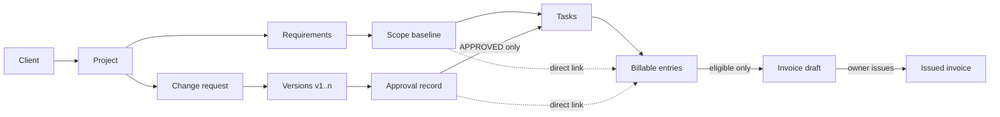
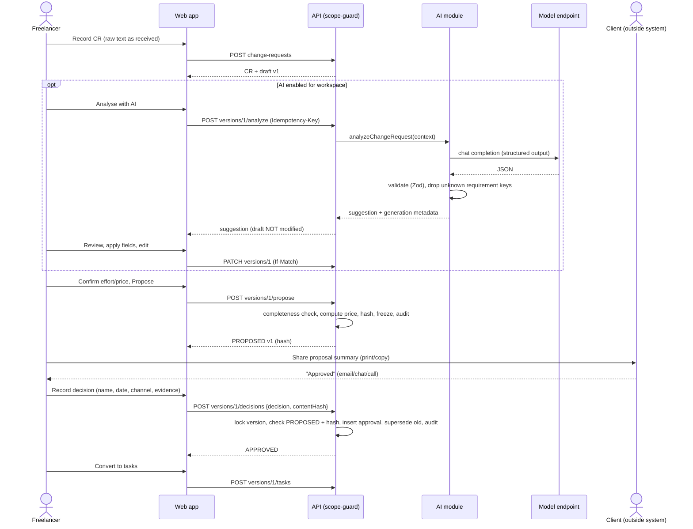
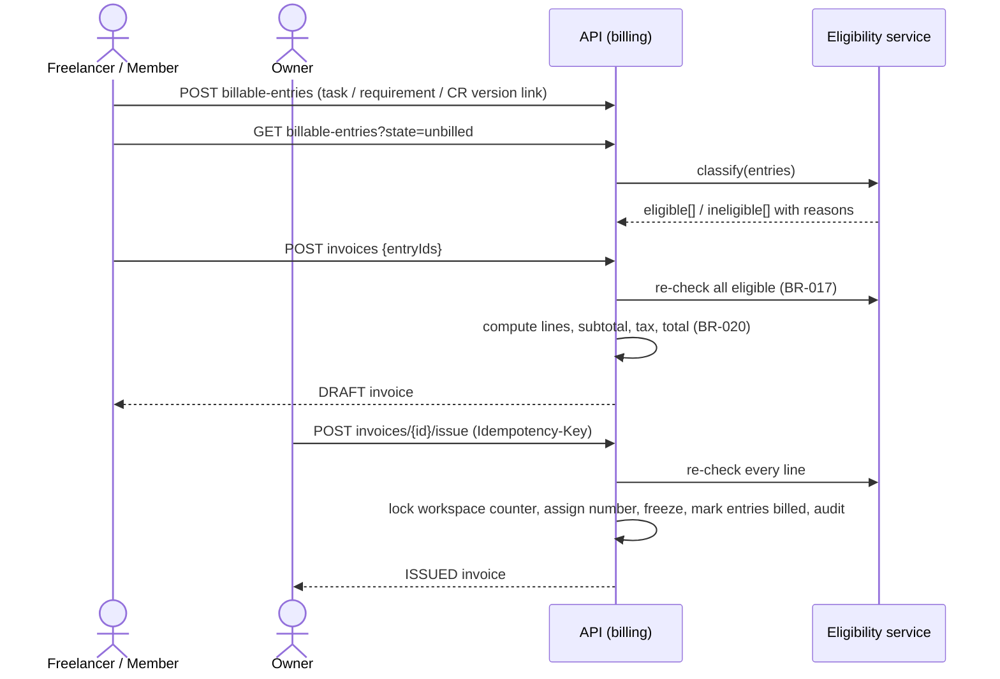
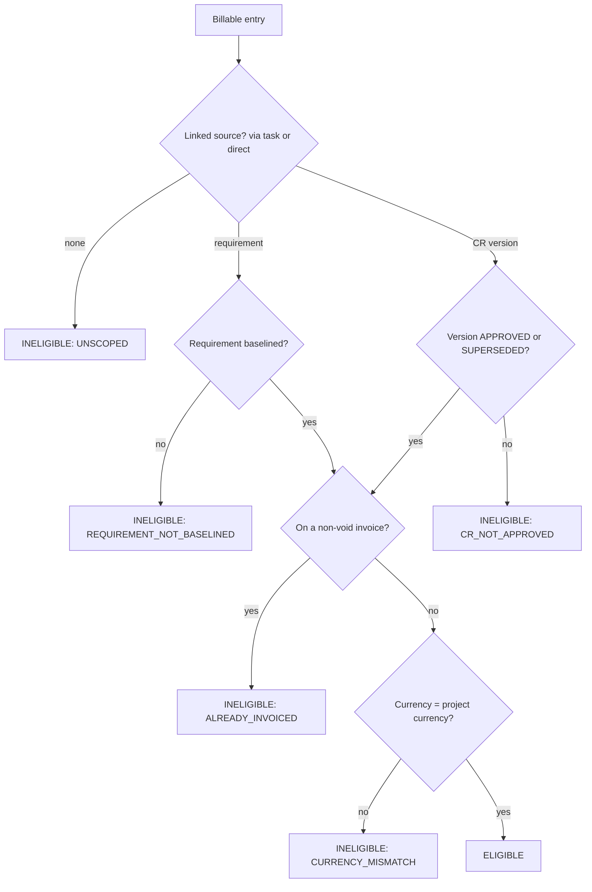
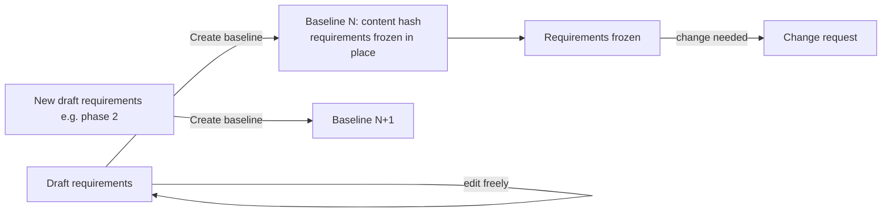
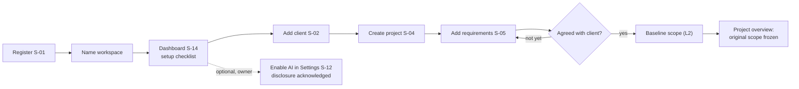
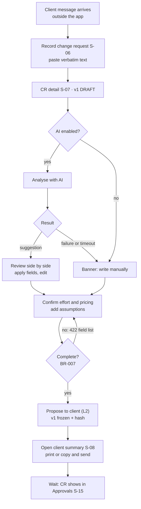
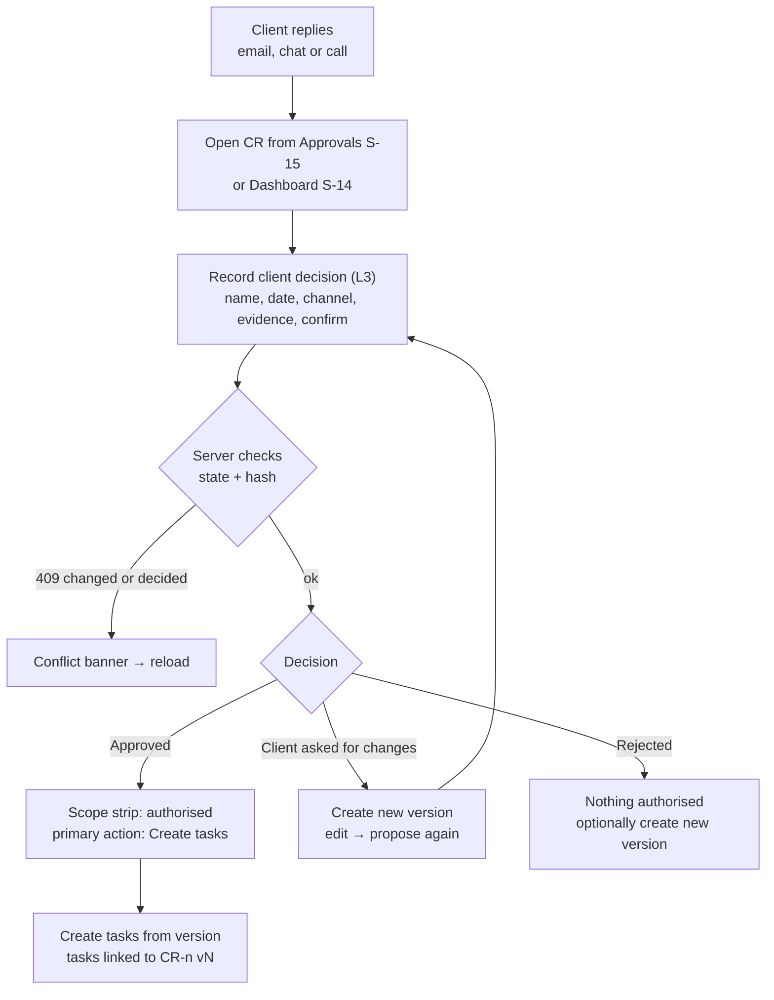
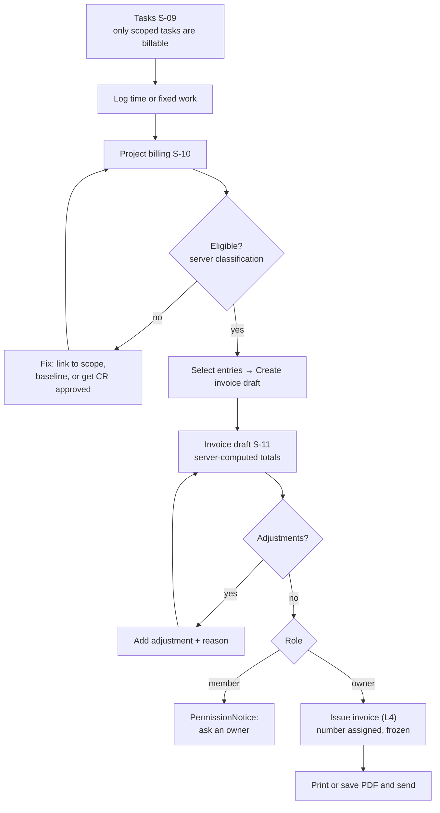
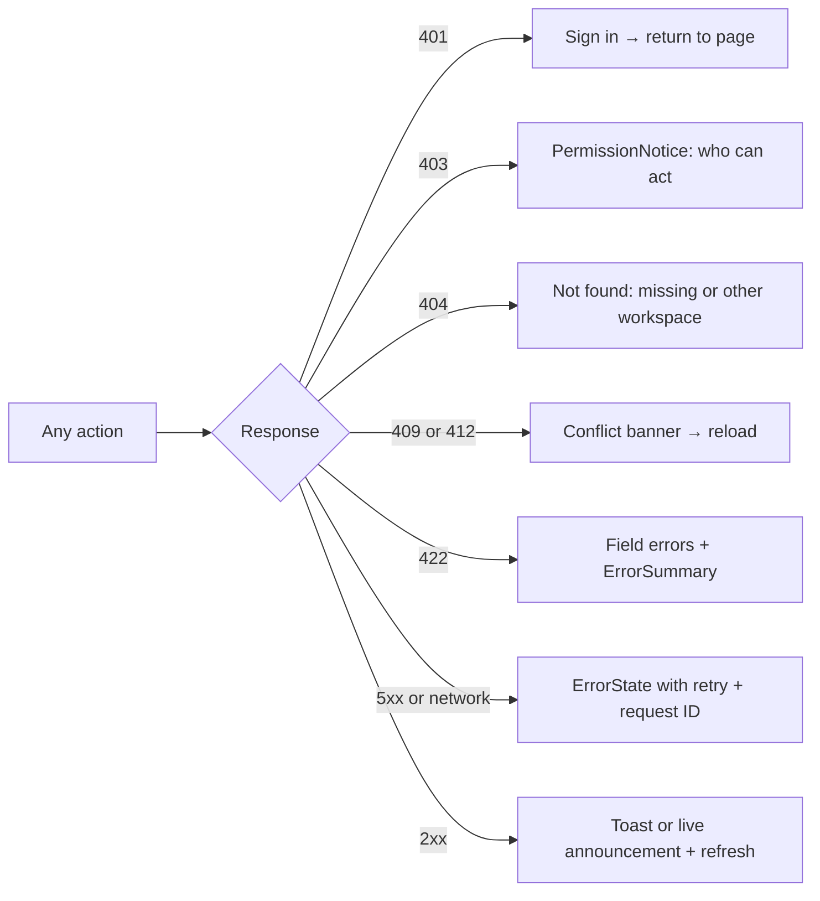

# Workflows and User Flows

Part A shows **system workflows**: how data and services interact. Part B shows **user flows**: what a person does, screen by screen. State rules live in [change-request-lifecycle.md](change-request-lifecycle.md), business rules in [business-rules.md](../product/business-rules.md), and screens in [screen-specifications.md](screen-specifications.md).

# Part A — System workflows

## 1. End-to-end traceability

## 2. Change request → approval (with optional AI)

## 3. Billable work → invoice

## 4. Eligibility decision

Reason codes are a closed enum shared by the API and UI: `UNSCOPED`, `REQUIREMENT_NOT_BASELINED`, `CR_NOT_APPROVED`, `ALREADY_INVOICED`, `CURRENCY_MISMATCH`. Entries on archived projects remain invoiceable if eligible, because archiving blocks only *new* work (BR-029).

## 5. Scope baseline

# Part B — User flows

Screen IDs refer to [screen specifications](screen-specifications.md#2-screen-inventory). Diamonds are user or system decisions. **Bold** steps need a human confirmation dialog (L2–L4 in the [design system](ui-ux-design-system.md#78-dialogs-and-confirmation-flows)).

## UF-1 First-run setup (J1)

## UF-2 Handle a client's extra request (J2, the core flow)

## UF-3 Record the client's decision (J2 continued)

## UF-4 Deliver and invoice (J3, J4)

## UF-5 Error and permission paths (cross-cutting)

## Human decisions versus automation

| Step | Who or what | Can it be automated? |
| --- | --- | --- |
| Capture the client's request text | Human (paste) | Email/chat intake is post-MVP. It would still create a **draft** only |
| Clarify scope, suggest effort, list assumptions and risks | **AI suggests**, human edits | Yes, as a suggestion only (BR-001) |
| Compute price from confirmed effort or a fixed amount | **Application** (deterministic) | Yes. It is never done by AI (BR-020, BR-027) |
| Propose (freeze) a version | **Human** (L2) | No |
| Approve, reject or request changes | **Client** decides. **Human** records it (L3) | No. AI and automation can never record decisions (BR-002) |
| Supersede old approved version, recompute CR status, write audit | **Application** | Yes, automatically inside the same transaction |
| Create tasks from an approved version | **Human** triggers, application creates | Pre-filled from acceptance criteria, confirmed by a human |
| Classify entry eligibility | **Application** | Yes (BR-016) |
| Compute invoice lines, tax and totals | **Application** | Yes (BR-020). Client and AI values are ignored |
| Issue or void an invoice | **Owner** (L4) | No (BR-023) |
| Assign invoice number | **Application** | Yes, inside the issue transaction |
