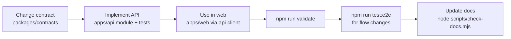

# Local Development

> **Status:** M1–M5 are implemented. **Verified (Windows 11, Node 22.14.0):**
>
> - **2026-10-18:** the Docker Compose database steps (`docker compose up -d mongo`, then `npm run db:migrate`, then API tests and E2E on it), in release audit [§11](../quality/release-readiness-audit.md#11-checklist-audit-second-pass-2026-10-18) and §12.
> - **2026-10-19:** a fresh `git clone` followed by `npm ci`, `npm run validate` and `npm run test:coverage`, in [§13](../quality/release-readiness-audit.md#13-final-release-closure-2026-10-19).
>
> **Not verified yet:** `npm run dev` with a manual browser walk-through, and runs on Linux or macOS. Report results in [implementation status](../quality/implementation-status.md#validation-log).

## Prerequisites

| Tool | Minimum | Notes |
| --- | --- | --- |
| Node.js | 22.12 (22 LTS) | `.nvmrc` says `22`. Some newer tool majors need ≥ 22.18, so they are deliberately not used yet ([ADR-0016](../architecture/adr/0016-m1-implementation-choices.md)) |
| npm | 10 | Ships with Node |
| Docker + Docker Compose v2 | recent | Only for the app's own development database. Tests do **not** need Docker |
| Git | 2.40+ | |

## First run

```bash
git clone <repo-url> soloops-ai && cd soloops-ai
npm ci                                   # installs all workspaces from the single lockfile
cp apps/api/.env.example apps/api/.env   # then set SESSION_SECRET (command in the file)
cp apps/web/.env.example apps/web/.env.local
docker compose up -d mongo               # mongod --replSet rs0, initialised by the health check (verified 2026-10-18)
npm run db:migrate                       # applies apps/api/migrations
npm run dev                              # API on :4000 and web on :3000 in parallel
```

Open http://localhost:3000 and create a workspace. In development the browser calls `http://localhost:3000/api/v1/...`, and Next.js rewrites those calls to `API_INTERNAL_URL`, so the app behaves as one origin, exactly like production ([ADR-0013](../architecture/adr/0013-web-api-communication.md)).

There is no seed script yet (`npm run db:seed` is planned).

## Tests (no Docker needed)

```bash
npm test                # unit + component + API integration
npm run test:e2e        # Playwright; run `npm run build` first and `npx playwright install chromium` once
npm run test:coverage   # all Vitest suites with coverage gates (reports in each workspace's coverage/)
npm run validate        # lint + typecheck + test + build + docs check (what CI runs, minus E2E)
```

- API integration tests start a **real single-node MongoDB replica set** with `mongodb-memory-server`. The first run downloads a `mongod` binary of about 780 MB into the user cache. Each test file uses its own database, which is dropped afterwards.
- To use the Compose database instead: `MONGODB_URI_TEST="mongodb://localhost:27017/?replicaSet=rs0" npm test -w @soloops/api`.
- E2E (`e2e/stack.mjs`) starts its own replica set, migrates, and runs the **built** API on :4000 and `next start` on :3100. Stop any dev server on port 4000 first.
- To run E2E against the Compose database instead, set `E2E_MONGODB_URI="mongodb://localhost:27017/?replicaSet=rs0"` (the CI job `docker-mongodb` does this). Each run gets a fresh `soloops_e2e_<timestamp>_<id>` database, dropped on exit; leftovers older than an hour are removed at the next start. Only local hosts are accepted unless `ALLOW_REMOTE_TEST_DB=true`. If another MongoDB holds port 27017, see [troubleshooting](troubleshooting.md).

## Day-to-day workflow



- Run a single workspace: `npm run dev -w @soloops/api` or `npm run dev -w @soloops/web`.
- Run a single test file: `npx vitest run test/identity.test.ts` (inside `apps/api`).
- Reset local data: `docker compose down -v` (deletes the volume), then `npm run db:migrate`.

## Using AI locally (optional)

AI analysis is implemented (M3) but **off by default** (`AI_PROVIDER=none`). To try it, set the following in `apps/api/.env`, restart the API, then turn AI on in Settings as an owner. `AI_PROVIDER=mock` gives deterministic test answers and is refused in production. The setup below, with Ollama, passed an integration smoke test on 2026-10-18. That checks the integration only; no model is evaluated or recommended (see [ai-architecture](../architecture/ai-architecture.md) §7):

```bash
# Install Ollama (https://ollama.com), then: ollama pull qwen2.5:1.5b   (about 1 GB)
AI_PROVIDER=openai-compatible
AI_BASE_URL=http://localhost:11434/v1     # Ollama's OpenAI-compatible API
AI_MODEL=qwen2.5:1.5b                     # any model your endpoint serves
AI_STRUCTURED_OUTPUT=json_schema          # strongly recommended for small models
AI_API_KEY=                               # only if your endpoint requires one
```

Check the status with `GET /api/v1/workspaces/<id>/ai/status`; it should show `"health":"ok"`. If the endpoint is down, analysis fails fast and the draft stays unchanged.

## Validation commands

See [monorepo root scripts](../architecture/monorepo-structure.md#root-scripts-planned), the [testing strategy](../architecture/testing-strategy.md#commands-once-m1-is-scaffolded) and the [definition of done](definition-of-done.md).
